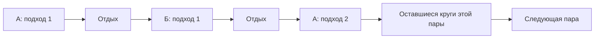
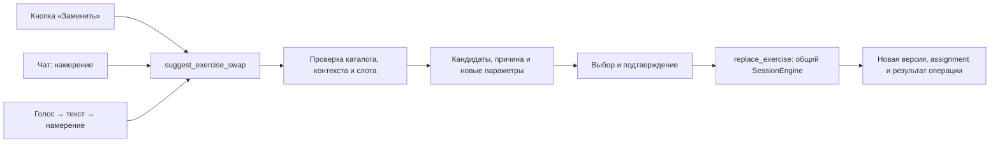

# ADR-0003: блоки занятий, таймеры, разминка и замены

Дата: 6 октября 2026 года.

Статус: принято для архитектуры и плана. Пользователь выбрал «Сначала архитектура и план». Код, SQL-миграции, БД, каталог и выполняемые занятия этим решением не изменяются. Методика новых комплексов и связей остаётся `draft/pending_expert_review`.

Решение дополняет [ADR-0001](0001-training-invariants-and-companion-context.md) и [ADR-0002](0002-catalog-ontology-and-skill-graphs.md). Не отменяет независимость difficulty, ролей, целей и assignmentGate, не меняет стабильные ID, UUID существующих ревизий и V1-снимки.

## 1. Требования и текущая реализация

Прямые требования пользователя:

- Основная силовая часть может содержать 10 упражнений в пяти парах. Чередуются подходы А и Б с паузами 30–60 секунд; после Б повторяется текущая пара, затем начинается следующая.
- Стретчинг и аэробные занятия используют таймеры. Аэробный комплекс может иметь основную часть на десять минут.
- Разминка видна перед основной частью и подбирается под занятие и условия.
- Упражнение заменяется через кнопку, чат или голос. В БД должны быть явные проверенные связи замен.
- Three.js-графика Макса/Лики допускается для временных/аэробных комплексов. В силовых остаются статичные карточки.

Фактическое состояние по локальным файлам:

| Область   | Сейчас                                                                                                        | Что предстоит                                              |
| --------- | ------------------------------------------------------------------------------------------------------------- | ---------------------------------------------------------- |
| Runner    | Плоские `exercises/currentIndex`; переход после всех подходов текущего упражнения                             | Блоки, чередование подходов, круги, стороны                |
| Результат | `RecordedSet.reps` применяется и к timed-карточкам                                                            | Разделение повторов и секунд по ADR-0001                   |
| Таймер    | Локальный `setInterval` в компоненте, без восстановления после remount                                        | Отдельный сохраняемый контроллер                           |
| Каталог   | 300 draft-вариантов; роли, стороны и семантика учёта существуют                                               | Применение этих полей в runner                             |
| Замены    | 216 направленных editorial `alternatives` у 134 карточек                                                      | Утверждённые правила и разрешения конкретных слотов        |
| 3D        | WEBP персонажей; GLB/glTF/rigged-моделей и motion clips в `public/` и `concepts/` нет; Three.js не установлен | Ассеты, проверка техники/прав, ограниченный renderer spike |

Числа замен получены из локального объединения JSON, не из запроса БД. 80 alternative-связей не имеют обратного ребра, 50 меняют `countSemantics`, 72 меняют `resistanceMode`; группы пересекаются. Такие кандидаты не являются готовыми разрешениями или основанием перенести дозировку.

## 2. Фаза, формат исполнения и метрика независимы

Фаза блока: `warmup | main | cooldown`.

Формат исполнения блока:

| Формат              | Порядок                                         | Пример интерфейса                          |
| ------------------- | ----------------------------------------------- | ------------------------------------------ |
| `straight_sets`     | Подходы одного упражнения, затем следующее      | Силовая карточка и отдых                   |
| `paired_sets`       | А1, пауза, Б1, пауза, А2…                       | Пара, текущий круг, А/Б                    |
| `timed_sequence`    | Последовательные упражнения/удержания на время  | Таймер позиции и отдельный переход стороны |
| `interval_sequence` | Зафиксированные фазы работы, отдыха и переходов | Таймер фазы и общего комплекса             |
| `continuous`        | Один непрерывный временной рабочий шаг          | Основная часть на 10 минут                 |

Направление каталога не определяет формат: силовой вариант может входить в пару, растяжка в timed_sequence, а роль «Разминка» не задаёт секунды. Аэробный режим относится к цели/структуре комплекса; таймер сам по себе не доказывает аэробную интенсивность. Расширение закрытого словаря направлений отдельным `aerobic` требует отдельной задачи на таксономию, validator и контент.

Метрика рабочего шага: `reps | time`. План и факт раздельны. Следуем единицам ADR-0001: `target_duration_seconds` и `duration_seconds` на сервере, целые граммы внешнего веса, `elapsed_ms` только у локального таймера. Имена `duration_ms` из прежнего эскиза логической БД следует согласовать при реализации; две несогласованные формы одного результата не создаются.

## 3. Модель данных и закрепление версий

Развиваем существующий эскиз [логической БД](../database-model.md), используя его `template_revisions`, `workout_versions` и `session_plan_assignments`. Не вводим рядом второй независимый механизм версий шагов.

| Сущность целевой модели          | Данные и связи                                                                                                                                      |
| -------------------------------- | --------------------------------------------------------------------------------------------------------------------------------------------------- |
| `template_revisions`             | Неизменяемая версия программы/комплекса, методическая проверка, версия DSL                                                                          |
| `template_blocks`                | FK на день/ревизию шаблона, ordinal, phase, execution_mode, rounds, правила переходов и пауз                                                        |
| `template_slots`                 | FK на блок; позиция А/Б или ordinal; разрешённые точные variant revisions; роли/цели и назначение                                                   |
| `workout_versions`               | Закреплённый снимок под конкретные условия, source/context/rules versions и parent version                                                          |
| `workout_blocks`                 | FK на workout version, порядок, формат, зафиксированные параметры, источник template block/routine revision                                         |
| `workout_items` и `planned_sets` | Упражнение и численные цели; item относится к блоку; стороны, смысл веса, exact revision/package refs                                               |
| `execution_units`                | Развёрнутый порядок исполнения внутри workout version: UUID, ordinal, block, item/planned_set для работы, round, side, phase `work/rest/transition` |
| `session_plan_assignments`       | Append-only назначения версий в одну сессию; граница вступления изменения и ссылка на предыдущее назначение                                         |
| `performed_sets`                 | FK на фактическое назначение, unit и исходную pinned variant revision; положительный факт повторов либо секунд                                      |
| Локальный timer checkpoint       | Owner, session/unit/device, состояние, активное время, deadline/checkpoint, generation; хранится в IndexedDB                                        |

У rest/transition-unit нет «выполненного подхода». Рабочая unit имеет ровно один planned_set. Unit принадлежит закреплённой workout version и может исполняться в разных сессиях: уникальность результата задаётся на `(session_id, execution_unit_id)`, с FK на допустимое назначение этой версии в той же сессии. Пара имеет ровно два логических рабочих слота, однако единиц исполнения больше: число зависит от кругов и сторон.

Составные FK обеспечивают совпадение владельца, workout version, блока, item и unit. FK на unit без соответствующего assignment недостаточен. Ordinal уникален внутри версии. Проверки комплексности пары, сумм времени и разрешений выполняются validator и транзакцией публикации; межтабличный CHECK этого не обеспечивает.

Новые версии получают новые UUID. Существующие `workout_steps` и их UUID не переименовываются. Прежний `RecordedSet.exerciseId` фактически является ID шага занятия, а не catalog ID: V2 вводит явные `unitId`, `itemId` и `variantRevisionId`.

Текущие требования ресурсов ещё привязаны к варианту, не к его ревизии. Этап 0.5 должен закрепить версии обязательных требований, количество, пригодность опор и способности оборудования в снимке. Один variant-revision FK не делает текущие mutable requirements неизменяемыми.

## 4. Исполнение и таймеры

Курсор V2 — `currentUnitId`; номер блока, пары, круга, стороны и упражнения выводится из закреплённой последовательности. Силовая пара разворачивается как:

Не добавляем финальную паузу случайно: паузы между участниками, кругами и блоками имеют отдельные зафиксированные правила. 30–60 секунд — требование к выбранному пользователем формату, а не универсальное правило для всех силовых программ. Общий шаблон пары проходит методическую проверку; совпадение/различие основной мышцы не заменяет её.

Стретчинг с `per_side_seconds` разворачивается в отдельные left/right work-units с понятным порядком и инструкцией перехода. «По 30 секунд» — две цели и два факта, а не неразличимая запись на 60 секунд. `total_seconds` не удваивается.

Аэробные «10 минут» в этом решении означают **600 секунд основной части по расписанию**, включая предусмотренные её интервальные паузы и переходы, но без отдельной разминки/заминки и пользовательских пауз. У continuous-блока это 600 секунд работы. UI различает основное время, фактическое время работы и общее время занятия. Сумма всех фаз interval_sequence должна совпадать с длительностью блока. Состав и плотность комплекса остаются pending expert review.

Общие действия: старт, пауза, продолжение, продление разрешённого отдыха, завершение/пропуск, переход стороны. Продление отдыха сначала меняет owner-scoped runtime/checkpoint; при фиксации границы таймера принятая команда/событие сохраняет выбранную или наблюдавшуюся длительность с указанием происхождения. Это не performed_set и не изменение исходного шаблона. Длительность и пределы проверяет политика блока; повтор boundary-команды идемпотентен, локальные тики не повышают серверную revision.

Таймер рассчитывает elapsed/deadline, а не считает число вызовов setInterval. В открытой странице используется монотонное время; на reload восстанавливается checkpoint. Скачок часов или неизвестный промежуток вызывает видимое восстановление с подтверждением. Сервер не получает запрос каждую секунду.

Политика первого пилота: рабочий таймер при скрытии страницы приостанавливается; отдых хранит deadline и может истечь в фоне. При возврате UI сверяет курсор/ревизию. Нет обещания точного звука на заблокированном телефоне: браузеры замедляют фоновые таймеры и останавливают animation frames. Wake Lock запрашивается для открытого режима и может быть отклонён/снят. Основание: [Page Visibility](https://developer.mozilla.org/en-US/docs/Web/API/Page_Visibility_API), [Screen Wake Lock](https://developer.mozilla.org/en-US/docs/Web/API/Screen_Wake_Lock_API).

Истечение таймера не записывает факт упражнения, не начисляет XP и не завершает занятие. В первом пилоте рабочая unit закрывается явным подтверждением либо пропуском. Для последующего режима автоматического показа интервальных инструкций отдельно сохраняются наблюдения таймера и подтверждённые факты: автопереход не подставляет target в actual.

Положительный факт может быть ниже цели. Для пилота пользователь явно завершает такой подход; unit считается выполненной, а достижение цели оценивается отдельно. Пропуск обязательных units даёт partial. Completed означает, что все обязательные units выполнены/подтверждены по политике шаблона, а не равенство факта численной цели.

## 5. Разминка как часть занятия

Перед основной частью UI показывает отдельный пункт «Разминка» с составом, длительностью и действием начать. Затем «Основная часть», при наличии «Заминка». Число «10 упражнений · 5 пар» относится к основной части: разминка не превращается незаметно в пару 1.

Разминочные комплексы используют существующие `template_revisions` типа routine и блоки phase=warmup. Их упражнения берутся из того же каталога, отдельные дубли карточек не создаются. Роль карточки лишь помогает искать кандидатов; допустимость конкретного применения и дозировку утверждает методист в routine/слоте.

План подготовки рецептов:

| Сценарий              | Что учитывает выбор                                                              |
| --------------------- | -------------------------------------------------------------------------------- |
| Фуллбоди              | Основные паттерны всей выбранной программы                                       |
| Силовая нижней части  | Движения основной части, доступные опоры/оборудование                            |
| Силовая верхней части | Тяговые/жимовые движения и реальные ресурсы                                      |
| Дом без инвентаря     | Поверхность, пространство, отсутствие неуказанных предметов                      |
| Аэробный комплекс     | Последовательность и характер основной части, возможность низкоударного варианта |
| Йога/стретчинг        | Положения тела, поверхности, коврик/блоки/ремень по требованиям вариантов        |

Место само по себе не определяет инвентарь. Улица/площадка фильтруются по реальной поверхности, пространству и предметам; «площадка» не обещает наличие всех станций.

Силовая подготовка также может включать подводящие подходы конкретного движения по утверждённому правилу. Они маркируются отдельно от рабочих, сохраняют реальные результаты и не подменяют рабочие цели/рекорды. Их нагрузка не генерируется свободным ответом модели.

Выбранная routine revision, причина выбора, версия контекста и итоговые steps закрепляются в workout version. Никакой произвольной рандомизации: допускаются только заранее проверенные варианты под контекст. Пропуск разминки — отдельное действие с сохранением истории; обязательность конкретной разминки задаёт шаблон, UI сообщает её заранее.

## 6. Проверенные замены в БД

Прежний эскиз `variant_replacements` уточняем, а не создаём конкурирующую таблицу. `alternatives/regressions/progressions` остаются редакционными данными. Даже существующее ребро alternative не разрешает runtime-замену.

| Тип связи                | Значение                                                                                                                   |
| ------------------------ | -------------------------------------------------------------------------------------------------------------------------- |
| `direct_substitute`      | Проверенная близкая замена: сохраняет нужную двигательную задачу, основной акцент, роль и цель слота при заданных условиях |
| `contextual_substitute`  | Допустима в определённом шаблоне, с отдельными параметрами/ограничениями                                                   |
| `related`                | Похожее упражнение для поиска/просмотра; не разрешение замены                                                              |
| `regression/progression` | Изменение требуемой способности; отдельная методическая связь                                                              |

Пользовательское «полная замена» означает direct_substitute **в проверенном контексте**, без обещания тождества всех эффектов. A→B не означает B→A; A→B и B→C не создают A→C.

`variant_replacements` хранит устойчивый code, UUID ревизии правила, revision_no, точные `from_variant_revision_id/to_variant_revision_id`, тип, policy_schema_version, строго типизированные условия/политику дозировки, reason, источники, статус публикации/проверки и проверяющего. Self-link запрещён, направление/ревизия уникальны, published-правило неизменяемо.

`template_slot_replacements` связывает слот с **точной ревизией** правила: допустимые роли/цели, параметры нового назначения и ограничения блока. Для paired_sets разрешение учитывает конкретную версию блока и второго участника. Изменение второго участника/отдыха требует нового разрешения, не прежней записи «на ноги».

При предложении и применении проверяются:

1. Владелец, активная сессия, исходное назначение и expected revision.
2. Исходная revision соответствует уже закреплённому назначению. Retired-источник может заменяться, сохраняя допустимую историю. Для revoked-источника действует отдельное проверенное recovery-разрешение: его дальнейшее исполнение запрещено, но отзыв не блокирует переход к разрешённой цели. Новая цель, правило и разрешение слота должны быть действующими и опубликованными/проверенными; draft/retired/revoked-цель не назначается.
3. Новое назначение проверяет assignment gate и skillDemand по ADR-0002; skill_review запрещён до движка оценки. Difficulty, опыт и мышечный акцент не обходят gate. Сохранённая исходная история не даёт права вновь исполнять неподдерживаемое навыковое движение.
4. Реальные ресурсы, количество и подтверждённые опоры, способности оборудования, версии контекста.
5. Цель/роль слота, движение, профиль и утверждённая пригодность; словари experience и difficulty не сравниваются как одинаковые значения.
6. Метрика, стороны, единица повтора, режим сопротивления и разрешённая новая дозировка.
7. Для пары: вторичные мышцы/стабилизаторы, хват, суммарная задача, отдых, переходы и конфликт станций.

Порядок фильтрации строгий, ранжирование выполняется после него. Неизвестное обязательное условие закрывает замену. Нет допустимого кандидата — UI честно сообщает это и предлагает явный пропуск либо разрешённое изменение программы.

В каталоге сейчас нет гакк-приседа. `strength.squat.barbell_back` имеет только редакционные alternatives на bodyweight/goblet; `strength.leg_press.machine` существует без alternative-ребра. Присед→жим ногами/будущий гакк можно подготовить как contextual-кандидат, но нельзя объявить подтверждённым direct без методической проверки. Новые упражнения в этом этапе не добавляются.

## 7. Параметры и история при замене

Нагрузка штанги не копируется в тренажёр. Sets, повторы/секунды, стороны, отдых и старт нагрузки входят в новый предпросмотр. Политика может сохранить отдельный проверенный параметр; отсутствие mapping блокирует применение, а не означает «оставить всё».

В первом пилоте новые веса сбрасываются в «нужно указать/подобрать» либо берутся из разрешённого правила и подходящей истории того же исполнения. `null` не превращается в ноль. Если новая метрика/side-count несовместимы, нужен самостоятельный утверждённый target adapter.

Принятая замена создаёт новую workout version и append-only session assignment. Исторический result остаётся на фактически выполненных revision/unit/assignment. Новый snapshot не изменяет старые строки, медиа и числа. Завершённые units не заменяются.

Первый рабочий срез 0.7a: текущий/будущий одиночный слот до первого подхода, онлайн. Срез 0.7b добавляет paired-блоки с явным разрешением совместимости и замену оставшейся части после фактических подходов. Журнал назначений фиксирует границу и ссылки на сохранённый префикс; новая версия содержит разрешённую будущую задачу. Перенос уже выполненного объёма и смена сторон проходят отдельное правило. Простой UPDATE текущего workout_steps запрещён как реализация замены.

Эффективное задание сессии состоит из сохранённого префикса принятых назначений и нового разрешённого хвоста. Старые будущие units, явно вытесненные принятой заменой, имеют состояние superseded: они не являются пропусками и больше не обязательны. Уже сделанные пропуски/результаты префикса остаются в истории. Completed/partial и фактический объём вычисляются по этой цепочке, а не только по последней workout version и не по сумме всех когда-либо планировавшихся units. Ссылки перенесённого факта не создают второй performed_set; XP остаётся однократным для терминального исхода сессии.

Офлайн-замена требует загруженных точных правил, template-разрешений, целевой revision и её обязательных медиа. Создаётся provisional assignment со своей operation ID; при синхронизации сервер проверяет всё заново. Отказ/отзыв не переписывает уже совершённые локальные факты: требуется явная сверка, а не тихое удаление очереди.

## 8. Кнопка, чат и голос

Все способы используют один сценарий:

Список предложений не меняет план. UI показывает исходное и новое упражнение, причину, параметры и область изменения: сегодняшнее занятие или отдельное обновление программы. По умолчанию заменяется только сегодняшнее назначение.

`replace_exercise` использует operationId, command_schema_version и expectedRevision. Сервер проверяет revision исходного назначения, точную relation revision, scope и параметры, блокирует сессию и сохраняет ACK в одной транзакции. Повтор проверяется до stale revision. Токен/ID предложения не отменяет повторной проверки при принятии.

Qwen только разбирает намерение и запрашивает разрешённые инструменты. Модель не утверждает связи, не выбирает произвольный SQL/вес и не считает отказ успешным действием. «Хочу другое на ноги» возвращает кандидатов, «замени на выбранный» — подтверждённую команду; неоднозначное «поменяй» уточняется.

Для голоса проектируется ASR adapter. Разрешение микрофона, язык, final transcript и неоднозначное распознавание отделены от подтверждения изменения. Свободная облачная речь/чат требуют сеть; кнопки, таймер и разрешённый кешированный подбор работают без Qwen. Browser ASR не обещаем офлайн на всех телефонах: платформенная служба и локальное распознавание имеют разные режимы. [Web Speech API](https://developer.mozilla.org/en-US/docs/Web/API/Web_Speech_API).

## 9. Three.js как подключаемая визуализация

Для strength-блоков renderer не загружается. Для timed/aerobic-блоков интерфейс принимает `static | three` presentation package. Таймер, текст, управление и журнал работают при отсутствии/сбое 3D.

Живая 3D-демонстрация требует геометрии персонажа, пригодного rig/skeleton, материалов, проверенных motion clips и подготовки под мобильное устройство. Наши WEBP сами по себе этим набором не являются. Three.js загружает glTF и воспроизводит clips; не генерирует корректную технику из картинки. Основание: [GLTFLoader](https://threejs.org/docs/pages/GLTFLoader.html), [Animation System](https://threejs.org/manual/pages/animation-system.html).

Метаданные ассетов расширяются media_kind, persona revision, skeleton/rig compatibility, variant revision для instructional-движения, clip ID, loop bounds, источник/права, техническая и методическая проверка. Используются planned `media_assets/media_packages` и immutable keys/hashes; бинарные файлы остаются в object storage. Исходный GLB, текстуры, codecs и runtime-зависимости включаются в manifest для заявленного офлайн-режима.

Демонстрация техники (`instructional`) отделена от декоративной реакции напарника (`companion_feedback`). Поддерживающая анимация не заменяет картинку техники. Клип/его fps не является измерением выполненных пользователем повторов. Loop speed разрешён только в проверенном диапазоне, а длительность клипа не определяет длительность упражнения.

Spike: по одному небольшому демонстрационному движению Макса/Лики из утверждённого пилота, проверка подходящей модели и одного устройства класса Android/iPhone, cold load, offline reload, повторное открытие/освобождение GPU, reduced motion, батарея/нагрев и отказ WebGL. Новая зависимость выбирается после проверки совместимости с установленными React/Next и условий ассетов. Пока Three.js/R3F не устанавливаем и FPS/размеры не обещаем.

Клиент загружает только выбранную persona, лениво открывает renderer, останавливает отрисовку скрытой страницы и освобождает ресурсы. Статичный пакет обязателен. Смена персонажа не меняет упражнение, темп назначения или дозировку.

## 10. Порядок реализации

| Этап | Результат                                                                                    | Зависимость                                         |
| ---- | -------------------------------------------------------------------------------------------- | --------------------------------------------------- |
| 0.5  | Метрики/вес, результаты/пропуски, терминальные состояния, pinned версии, совместимость V1/V2 | ADR-0001                                            |
| 0.6a | Блоки, execution units, пары, стороны, общий timer controller                                | 0.5                                                 |
| 0.6b | Разминка, continuous/interval/timed UI и офлайн-восстановление                               | 0.6a и проверенные routine-кандидаты                |
| 0.7a | Versioned replacement rules/slot permissions, предпросмотр и онлайн-команда                  | 0.5/0.6a; опубликованный пилот                      |
| 0.7b | Разрешённые замены в парах и частично выполненных слотах                                     | 0.7a; методическая совместимость и journal boundary |
| 0.7c | Пакеты альтернатив и provisional замены без сети                                             | 0.7b; sync/отзыв/конфликт                           |
| 1–2  | Авторство персонажей, Qwen/ASR и тот же сценарий через чат/голос                             | Готовые детерминированные команды                   |
| 2.1  | Ограниченный 3D spike и затем выбранный timed-пилот                                          | Проверенные модели/клипы и рабочий timed UI         |

Это порядок готовности, не обещание календарных сроков. Методическая подготовка пилота идёт параллельно 0.5, а публикация контента должна предшествовать первой выдаче реальному пользователю.

Миграции планируются additively: validators/adapters → новые nullable поля/таблицы → baseline существующих достоверных снимков → V2 только для новых назначений → UI/offline upgrade. Не угадываем неизвестные исторические секунды, источник шаблона или профиль. Сохраняются исходные JSON-значения pending payload, operation/result IDs, прежние validators/hash-нормализация и совместимые сохранённые ACK. Текущие JSONB/Dexie не хранят исходные wire-байты, поэтому байтовое тождество не обещается; raw bytes сохраняются только там, где они действительно записаны. Legacy next_exercise не становится переходом А→Б.

## 11. Приёмка будущей реализации

- [ ] Пять пар исполняются по подходам; переход к паре 2 не пропускает оставшиеся круги пары 1.
- [ ] Односторонняя растяжка хранит отдельные стороны и факты, total_seconds не удваивается.
- [ ] Continuous/interval main имеет корректный бюджет 600 секунд; разминка, пользовательские паузы и rest units различаются.
- [ ] Таймер проходит pause/resume, hidden/visible, remount/reload, скачок часов и потерю сети; нет записи подхода по одному expiry.
- [ ] Разминка соответствует ресурсам/основной части, pinned routine, явному пропуску и версии.
- [ ] Related/regression/one-way/transitive-связи не обходят разрешение замены, gate и опубликованный статус.
- [ ] Нет копирования килограммов между исполнениями; метрика, стороны и новые параметры проверены.
- [ ] Замена сохраняет прежний префикс фактов; snapshot/assignment/unit FK не смешивают версии или владельцев.
- [ ] Superseded-хвост не требует повторного выполнения и не превращается в пропуск; completion учитывает действующую цепочку назначений, результат unit уникален внутри сессии.
- [ ] Retired-источник допускает проверенную замену; revoked запрещён для исполнения, но допускает отдельный recovery-переход; цель остаётся действующей.
- [ ] Устаревшее предложение, отзыв, гонка с записью подхода и конфликт устройств дают явный результат.
- [ ] Повтор операции после потерянного ACK/обновления не создаёт второй факт, assignment или XP.
- [ ] V1 UUID/ID/очереди сохранены, неоднозначные legacy-данные не выдаются за проверенное время.
- [ ] UI, чат и голос дают одинаковое действие; evals покрывают неоднозначность, отказ и ложное сообщение об успехе.
- [ ] 3D можно выключить/не загрузить без потери тренировки; media/package review и права проверены.

Сейчас выполнена архитектурная проверка локального кода и документов. Перечисленные runtime-проверки, миграции, ASR/Qwen-evals и 3D spike ещё не запускались.

## 12. Связанные материалы

[Roadmap](../miron-roadmap.md), [логическая модель](../database-model.md), [архитектура](../architecture.md), [контракт напарника](../companion-orchestration.md), [парные UI-концепты](../../concepts/miron-paired-sets-2026-10-06/README.md), [семантический QA каталога](../catalog-semantic-qa.md).
