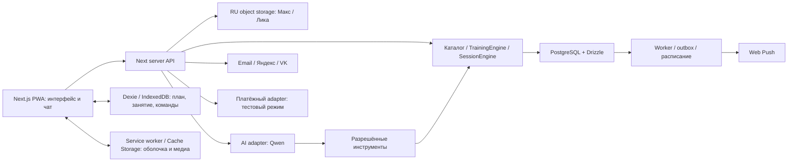

# Архитектура MIRON

12 октября для beta 0.1 подключён ограниченный Qwen-чат через PlusVibe: профиль и факты текущего занятия, read-only tools библиотечного подбора, явное подтверждение черновиков и коррекции приблизительного расхода. Контекст, число запросов и расход ограничены; история/идемпотентные ответы разделены по владельцу и напарнику. Подробности выпущенного среза и актуальные ограничения имеют приоритет над описаниями будущих этапов ниже: [beta 0.1](beta-0.1-deployment.md). Подписка, питание и отдельный облачный ASR-worker в этот срез не входят.

11 октября [comic-знакомство и дашборд по CJM](comic-onboarding-preview.md) подключены к реальному аккаунту. Вход через Яндекс открывает `/auth/continue`: сервер направляет новый аккаунт в знакомство, завершивший его — в новый дашборд. Публичный `/story` остаётся отдельным дизайн-прототипом без приватных записей; `/demo` открывает этот новый прототип. Старые экраны используются только в явном legacy-demo для регрессионных проверок.

9 октября подключён отдельный [самостоятельный конструктор](manual-workout-builder.md): выбор места/направления, запоминаемый инвентарь, фильтры каталога, собственные именованные шаблоны в PostgreSQL и оценка длительности. 10 октября подключён [подбор тренировок](workout-planner.md): full body/split, разовое занятие, цельные дополнительные комплексы, фактическая история, замены, исключения, сравнение и неизменяемые подтверждённые ревизии; библиотечный день запускается в настоящем runner, включая пары A–Б. Вход из story открывает путь реального аккаунта; preview не сохраняет приватные данные от своего имени. Старт отдельного собственного шаблона и AI-чат ещё не подключены.

Целевые сценарии выпуска обсуждаются в [карте пользовательских путей](user-journey-map.md) от 8 октября: чат как основной путь подготовки занятия, ручной конструктор для правок, календарь, активное занятие и общий путь. Принятый старт trial — при успешной регистрации; документирование этих решений не подключает функции к прототипу.

Уточнение пользователя 8 октября: профессиональный method review не входит в план подготовки тренировок; библиотека предлагается как явно обозначенные черновики. Самостоятельный конструктор доступен отдельно, примерное время считается по назначениям упражнений. [Новая спецификация](workout-drafts-and-duration.md) заменяет прежнюю обязательность экспертного review в целевом процессе; технические допуски, проверки ресурсов, прав и ограничений сохраняются. Прежние 18 черновиков V1, 8 схем и 300 профилей времени сохранены отдельно от новой runtime-библиотеки из 30 шаблонов; записи V1 не импортированы в подбор или опубликованный каталог.

Актуально на 11 октября 2026. Локальная первая реализация создана: Next.js, PostgreSQL/Drizzle, Better Auth, экраны, офлайн-журнал, серверный ASR и библиотечный подбор с запуском подтверждённого дня. Фактические настройки — [README](../README.md), [схема и миграции](database-setup.md), [проверки](verification.md). Ниже также описана целевая архитектура будущих этапов: Qwen, подписка, фоновый outbox-worker и пуши ещё не подключены. Детали данных — [модель БД](database-model.md), этапы — [roadmap](miron-roadmap.md).

Дальнейшие решения и порядок работ закреплены в [ADR-0001](adr/0001-training-invariants-and-companion-context.md): инварианты до AI-действий, одна достоверная история пользователя, подтверждённая память и передача разговора между персонажами.

Напарник закрепляется за текущим занятием: сервер отклоняет смену при `ready`/`active`, а новый дашборд блокирует выбор. Старт и смена сериализуются блокировкой строки владельца. После `completed`/`partial`/`aborted` смена разрешена при отсутствии другого текущего занятия; пауза и выход запрет не снимают. Это ограничение из [CJM](user-journey-map.md) и ADR-0001 реализовано 11 октября; будущие AI tools должны вызывать тот же доменный путь.

В этапе 0.5 реализованы фактические секунды отдельно от повторений, ручные work/rest таймеры, пропуск с сохранением подходов и completed/partial/aborted. [ADR 0005](adr/0005-daily-xp-and-workout-outcomes.md) задаёт main 50/25, support 20/10 и серверный daily_xp ledger с пределом 50 и доплатой разницы. Категория и московский день закрепляются при старте; офлайн-клиент получает подтверждение награды в ACK. Подбор сохраняет неизменяемые версии программы и снимки запущенного дня; полный будущий контракт метрик и точная роль коротких силовых/длинных аэробных занятий ещё требуют отдельной реализации.

Парные подходы, таймеры стретчинга/аэробных комплексов, разминка, проверенные замены и подключаемая Three.js-визуализация закреплены в [ADR-0003](adr/0003-workout-blocks-timers-warmups-and-replacements.md). 10 октября реализована ограниченная часть: пары A–Б, pinned фазы/отдых, редакционные сопоставимые замены и запуск подтверждённого библиотечного дня. Аэробные интервалы и Three.js остаются будущими интеграциями.

Единый платный продукт — [ADR-0004](adr/0004-product-subscription-and-archive-access.md): полный trial 168 часов, одна подписка 299 ₽/месяц, затем read-only архив. Entitlement активного продукта проверяется сервером отдельно от auth и AI quota; скачанный план не даёт будущие бесплатные старты. Одно заранее admitted занятие и AI-intent имеют ограниченный путь завершения/синхронизации. Это новая целевая модель, текущие workout endpoints ещё не применяют её.

## 1. Основное решение

12 октября подключена автоматическая примерная оценка расхода тренировки: [метод и сценарий](workout-drafts-and-duration.md#примерный-расход-энергии-требование-от-12-октября-2026). Снимок `met-performed-v1` создаётся в транзакции завершения по записанным подходам и типовым параметрам времени. Масса — ранее сообщённая владельцем либо явно подписанный ориентир 70 кг. Серверная команда `estimate_energy` пересчитывает снимок по уточнениям, не меняя журнал подходов/XP; используется тот же owner-scoped offline journal и идемпотентный ACK. Qwen/tool calling и раздел питания не подключены.

11 октября упрощён выбор условий в конструкторе/подборе: одна иллюстрированная карточка задаёт место и направление. Инвентарь выбирается картинками по направлению, единичные и парные веса взаимоисключаются; стандартное оснащение зала сохраняется сервером без отдельного вопроса. Подробности — [самостоятельный конструктор](manual-workout-builder.md).

Next.js / React / TypeScript, модульный монолит. Next обслуживает UI и серверные endpoints; фоновые задания выполняет отдельный Node.js worker с тем же доменным кодом. PostgreSQL — единый серверный источник истины; S3-совместимое хранилище в РФ — файлы. Офлайн-состояние на устройстве отделено от серверного.



Основные пользовательские данные, backend logs, медиа и резервные копии размещаем в РФ. Внешние AI, OAuth, почта, Web Push и наблюдаемость рассматриваются как отдельные потоки данных; одно RU-хранилище не закрывает вопросы всех интеграций.

## 2. Технологии и границы

| Часть        | Решение                                                                                 |
| ------------ | --------------------------------------------------------------------------------------- |
| Frontend/API | Next.js App Router, React, TypeScript; обработчики вызывают общие domain services       |
| DB           | PostgreSQL, Drizzle ORM, драйвер pg, версионированные SQL миграции                      |
| Validation   | Общие typed DTO и runtime-схемы, например Zod; проверка на сервере обязательна          |
| Offline      | Dexie поверх IndexedDB для данных; service worker/Cache Storage для файлов              |
| Media        | Object storage S3-compatible в РФ; файловый dev adapter за тем же контрактом            |
| Jobs         | PostgreSQL outbox и отдельный Node worker; Redis не обязателен для первого объёма       |
| Auth         | Better Auth 1.7.7: Яндекс подключён локально; VK неактивен, email/password за флагом    |
| AI           | Провайдерский адаптер Qwen; контракты инструментов принадлежат приложению               |
| Checks       | TypeScript, Vitest или совместимый runner для домена, Playwright для сквозных сценариев |
| Deployment   | Контейнеры web/worker, RU-сервер и PostgreSQL; stage отдельно от live                   |

Версии фиксируем при scaffold после проверки совместимости, а не по непроверенному latest. Документация [Drizzle/PostgreSQL](https://orm.drizzle.team/docs/get-started/postgresql-new) и [Dexie](https://dexie.org/docs/Tutorial/Design) — исходная точка spike; пример с release candidate не означает автоматический выбор RC для продукта.

Предлагаемая структура одного проекта:

```text
src/app/                 страницы и HTTP endpoints
src/modules/auth/        session principal и способы входа
src/modules/catalog/     варианты, ресурсы, публикация, поиск
src/modules/programs/    шаблоны и TrainingEngine
src/modules/workouts/    TrainingSessionEngine, результаты, команды
src/modules/progress/    XP и ачивки
src/modules/assistant/   контекст, gateway, tools, usage
src/modules/notifications/ preferences, задания, delivery
src/modules/billing/     entitlement и payments adapter, позже live
src/db/                  Drizzle schema и запросы
src/offline/             Dexie и очередь операций
src/worker/              outbox, планировщик, ограниченные retries
drizzle/                 SQL migrations
data/catalog/            editorial inputs, не автоматическая публикация
public/                  PWA icons/manifest и публичная оболочка
```

Без отдельного Nest backend, Kafka, векторной БД и CMS на старте. Модули можно выделить позже, если появится конкретная причина. Доменная логика не находится внутри React-компонентов.

## 3. Каталог, программы и публикация

В редакционной базе реализованы 300 draft-карточек и отдельные места `home/gym/outdoor/workout_park`. `variant_revisions.editorial` хранит короткое и точное имя, алиасы, поисковые слова, места/направления, многозначные роли в занятии и цели, редакционный приоритет и семантику выполнения. Справочник `muscle_groups` и связи `variant_revision_muscles` описывают основной акцент, другие мышцы и стабилизацию конкретной ревизии. Сложность, подсказки и кандидаты замен остаются черновиками; публикация требует отдельной проверки. [Фактическая схема и таблица](reference/README.md), [контракт и источники](../data/catalog/README.md).

Графы подготовки навыков хранятся отдельно: `skill_graph_revisions`, `skill_graph_nodes`, `skill_graph_edges`. Узлы привязаны к точным ревизиям упражнений, а составные FK не позволяют связать узлы разных версий графа. Активны семь графов revision 2; 14 revision 1 сохранены исторически. `prerequisite` отличается от `preparation`, все оценки ручные. Сложность, роль и цель не определяют допуск: `skillDemand` с обоснованием отдельно различает обычную работу, подготовку и движение, требующее освоенного навыка. Только последнее имеет `skill_review` и обязательное допустимое членство в активном графе. Этот gate блокирует автоматическое назначение до появления движка оценки. Метаданные каталога не заменяют изменения численных целей и офлайн-команд этапа 0.5. [Решение и границы](adr/0002-catalog-ontology-and-skill-graphs.md).

Семейство упражнения имеет стабильный ID и локализованные имена. Вариант задаёт исполнение, ресурсы, метрику, стороны и конкретную методику. Условия представлены обязательными AND-группами с OR-альтернативами, числом предметов и требованиями к опоре/пространству. Необязательный предмет не блокирует вариант.

Место — контекст пользователя. Сохранённый контекст содержит реальный инвентарь, а конкретная сессия может иметь override. Машины и свободные веса допускаются дома или в зале, если подходят ресурсы. Bodyweight — тип сопротивления, не предмет. Details — [каталог](exercise-catalog.md).

Целевой процесс уточнён: источник с разрешённым использованием → русский рерайт/собственная инструкция → редакционный черновик → техническая подготовка данных/собственных изображений и проверка прав → явная доступность черновика. Обязательный method review исключён по решению пользователя; факт его отсутствия сохраняется отдельно от продуктовой доступности. Рерайт не отменяет атрибуцию/лицензию исходного текста. Все исходные записи, переводы и изменения имеют происхождение. Зафиксированные доступные версии неизменяемы; новая правка создаёт новую revision.

Наличие доступной карточки и инвентаря не даёт автоматического допуска: действуют отдельные правила уровня, навыковых требований, роли и параметров. Такие редакционные правила не называются экспертным заключением. Распространённое имя не делает штангу/подтягивание автоматическим выбором новичка. Текущий `getPublishedCatalog` пока сохраняет прежний фильтр; новая доступность конкретных draft-версий требует явного контракта и статуса, а не открытия всего draft-каталога.

Обычное снятие из новых назначений (retired) отделяем от отзыва ошибочной техники/прав (revoked с причиной). Retired сохраняет разрешённые pinned занятия, если условия это позволяют. Revoked блокирует новые выдачи/пакеты; при следующем соединении клиент получает invalidation, перестаёт предлагать отозванную карточку и получает утверждённую замену с подтверждением изменения плана. Фактические результаты не удаляются и не переписываются. Немедленная удалённая блокировка на полностью офлайн-устройстве невозможна; ограничение отражаем в процедуре отзыва и сроках действия пакета.

Шаблон программы задаёт цикл занятий, роли/порядок блоков, параметры нагрузки и разрешённые замены. Пользовательский план фиксирует конкретные версии шагов и ресурсов. Full body и split — организация недели, независимая от места/инвентаря. TrainingEngine не заменяет недоступную тягу случайным упражнением на «те же мышцы».

В целевой модели фаза блока (разминка/основная часть/заминка), формат исполнения (обычные подходы/пары/последовательность на время/интервалы/непрерывная работа) и метрика результата независимы. Пара разворачивается по подходам А–Б, а временные упражнения — с явными сторонами. Проверенная замена связывает точные ревизии упражнений и разрешение конкретного слота/блока; создаётся новая версия будущего назначения с сохранением выполненной истории.

## 4. Медиа и персонажи

В первой версии используются собственные сгенерированные статические изображения, отдельно Макс и Лика. Изображения привязаны к variant revision, persona revision, ракурсу и ключевому кадру. Публикация двух персонажей требует общей проверки техники и анатомии. Нет обязательного WebGL, 3D-сцены или видео.

Для timed/aerobic-пилота предусмотрен отдельный renderer spike на Three.js с rigged-моделями и проверенными клипами. Силовые сохраняют статичные карточки. GLB/клипов пока нет; Three.js не установлен. Отказ или отключение 3D оставляет текст, изображение, таймер и управление. Renderer не хранит фактические результаты и не определяет завершение занятия.

В PostgreSQL лежат object key, checksum, размер, MIME, происхождение/права и состояние проверки; двоичные файлы — в object storage. Версионные immutable keys исключают подмену старой карточки новым изображением. Source master и компактный пользовательский derivative хранятся отдельно.

Публичные разрешённые карточки можно отдавать с cache/CDN, если выбран RU-маршрут и права включают offline. Пользовательские экспорты и будущие приватные вложения находятся в другом bucket/prefix и выдаются только после проверки владельца. Signed URL не является постоянным ID; пакет хранит asset ID/key и hash.

Текст, таймер и управление доступны до загрузки изображений. Переходы интерфейса учитывают reduced motion. Подгружается персонаж пользователя; второй набор по явному запросу.

## 5. PWA и офлайн

Комплект [icons/manifest уже подготовлен](pwa-assets.md); он ещё не является работающим офлайн-приложением.

Offline package включает версию user plan/workout, ревизии карточек, media manifest с размером/hash и необходимый набор выбранного персонажа. Явная кнопка загрузки; «Готово офлайн» только после проверки всех обязательных данных. Частичная загрузка, истёкший URL, нехватка места и очищенный браузером кеш имеют видимые состояния.

Статическая оболочка и известные разрешённые файлы кешируются по стратегии service worker. Приватные API, чат, auth, платежи и непросмотренные данные не складываются в общий кеш. IndexedDB и Cache Storage отделены по аккаунту/версии. Выход/смена аккаунта приостанавливают отправку и очищают пользовательский кеш; очередь A никогда не уходит из сессии B.

Локальное действие хранит operation ID, session ID, порядок устройства, ожидаемую серверную ревизию и параметры. Клиент показывает provisional state. Сервер в транзакции проверяет права/ревизию, сохраняет результат команды и применяет изменение один раз. Повтор возвращает прежний результат.

В конфликте двух устройств не перезаписываем silently. Первое исполнение принято; второе требует сверки и отдельного решения. Активное занятие продолжает pin исходной версии контента. Обновление SW/локальной схемы не перезагружает принудительно незавершённую тренировку.

Офлайн работают загруженные карточки, подходы/время, таймер, переходы и подготовленные реакции. Произвольный облачный Qwen-диалог требует сеть. Не выдаём подготовленные реплики за живой ответ AI.

По решению пользователя 8 октября 2026 голосовой ввод работает только с интернетом. Офлайн-модели на телефон не загружаются. Микрофон недоступен с пояснением «Голосовой ввод доступен с интернетом. Пока можно вводить текст». Текст, ручная запись работы и таймеры сохраняются. Потеря сети отменяет диктовку; поздний ответ не меняет черновик; восстановление не запускает микрофон. navigator.onLine не доказывает доступность сервиса.

В обоих чатах подключён MediaRecorder → Next voice API → Python ASR-worker: Groq первым, прогретый CPU Whisper резервом. Расшифровка — редактируемый текст, не AI-действие. Проверяются доступ, квоты, размер потока, фактическая длительность, кодек и речь. Локальный preview использует подписанную dev-cookie, production требует аккаунт. MIRON не сохраняет аудио; модели находятся на сервере. [Реализация и проверки](voice-input.md). Платный entitlement и документы публичного потока остаются отдельной работой.

## 6. Аккаунт и права

По последнему решению пользователя SMS исключён. Реализован email/password с подтверждением и восстановлением через Better Auth; настройки Яндекс ID и VK ID подготовлены, живой OAuth проверяется с реальными dev credentials. Подключение и объединение способов входа требуют доказательства владения; автоматическое связывание по совпадению email отключено. Подробности — [авторизация](auth-setup.md).

Auth schema библиотеки отдельно от тренировочных данных, связь через устойчивый principal user ID. Не пишем свою криптографию и token/session engine. Локальный dev-профиль допустим только в закрытой dev-среде и не считается способом публичного входа.

Все private reads и mutations фильтруются по principal. Foreign IDs проверяются до выдачи данных и до сборки контекста Qwen. Контакт, OTP, OAuth token и push endpoint исключены из обычных logs. Опубликованный каталог может быть общим, private user plan/sessions/чат — нет.

## 7. Действия и деньги

TrainingSessionEngine — общий контракт кнопок, поддерживаемых локальных команд и Qwen-tools. Подходы, переходы, исправления и finish используют operation ID и ожидаемую ревизию. Server-only XP ledger имеет уникальную ссылку на награждаемое событие. Клиент не выбирает размер награды.

Проба всего продукта: один раз, 168 часов от успешного создания аккаунта, автоматически при регистрации по принятому решению 8 октября. Лендинг объясняет условия до регистрации. Подтверждение email, завершение onboarding, создание плана, повторный вход и привязка провайдера не обновляют срок. Paid periods, полезные AI-ответы, provider spend и abuse counters учитываются отдельно. Подтверждённый email/OAuth не доказывает уникальность человека; SMS не добавляется. Product entitlement не подменяется user/security status и не блокирует account/export/delete/archive reads. Для новых workout/AI-действий применяется capability map ADR-0004; replay/unknown ACK восстанавливается по исходной owner-scoped операции до проверки нового коммерческого доступа.

Billing подключается сначала в тестовом режиме. Доступ выдаёт подтверждённый сервером платеж/период, а не экран success. Provider event ID, idempotency key, сумма/валюта и принадлежность merchant проверяются. Повторы webhook не создают новый период. Отмена продления сохраняет оплаченный срок; возврат рассматривается отдельно.

Реальная оплата после бизнеса, договоров, условий подписки, применимой фискализации и live-проверки. При окончании продуктового доступа история/программа/чаты читаются в архиве; новые занятия, адаптации и AI недоступны. Подписка не стирает earned прогресс и не отменяет ограниченные ранее admitted outcomes. Trial/paid имеют одинаковые выпущенные возможности; календарный месяц и точные границы закрепляются версией плана.

## 8. Уведомления и worker

С первых доменных событий предусмотрены workout.completed, schedule.changed и события прав доступа. Outbox пишется в одной транзакции с изменением сущности; worker берёт задания с lease/ограниченным сроком, не выполняет внешнюю сеть внутри долгой транзакции.

Для очереди PostgreSQL может использовать row locking/SKIP LOCKED; документация предупреждает, что это предназначено для queue-like доступа, а не общего согласованного чтения. [PostgreSQL SELECT](https://www.postgresql.org/docs/current/sql-select.html).

Preferences: отдельные категории, timezone IANA, локальное время, quiet hours, версия настроек. Notification job: semantic event key, due_at/expires_at, версии плана/настроек, статус и attempts. Перед отправкой повторно проверяются согласия и актуальность. Уникальный ключ не обещает exactly-once отображение на устройстве.

В v1 заранее утверждённые копии текста и комплексы. Recovery selection фильтрует совместимость прежде вариативности; история недавних комплексов уменьшает повторы. Доставка не гарантирует точную минуту, физиологическая готовность не вычисляется из «вчера тренировался». [Сценарии](notification-scenarios.md).

## 9. Реальные данные и эксплуатация

До beta определить оператора, основания/условия обработки, необходимые согласия, права контента и сроки хранения. Анкета не собирает диагнозы и документы; свободный чат всё равно может содержать чувствительную информацию. Минимизация payload не отменяет проверку внешних потоков. Исследование Qwen сначала на синтетических данных.

Secrets только server-side, без NEXT_PUBLIC; ключи по средам. Logs с request/operation IDs, состояниями, latency и usage, без полной переписки. Отдельные доступы web/worker, защита админки, миграции stage перед live. Backup в РФ и проверяемое восстановление, а не только расписание копий.

Удаление: отозвать session/keys, cancel jobs/subscriptions, удалить или обезличить соответствующие пользовательские данные по установленным основаниям; shared exercise assets не удаляются вместе с одним пользователем. Локальные данные офлайн-устройства невозможно немедленно стереть с сервера: обработка удаления/очистки выполняется при следующем соединении. Backup retention и повторное применение deletion tombstones фиксируются до реальных пользователей.

## 10. Что проверяем до первого выпуска

Каталог: AND/OR и количество ресурсов; unknown не проходит обязательное требование; session override; draft не назначается; ревизии/изображения совпадают. Сессия: duplicate op, потеря ответа, исправление подхода, завершение один раз, два устройства, истекшая auth и смена аккаунта. Офлайн: авиарежим, закрытие/возврат, частичный пакет, недоступная память, обновление версии.

AI: корректные server tools, неоднозначная команда, недоступный провайдер, сообщения о боли без автоматического повышения нагрузки, права, token/tool-step budget. Push: тихие часы/часовой пояс, отписка, stale job, TTL и retries. Billing: дубль/потеря webhook, timeout, cancellation и проверка period grants.

Это критерии будущих тестов. Реальные API/evals, browser E2E, миграции и beta ещё не запускались.

## 11. Расходы на ИИ и защита от спама

Qwen — выбранная основа. Endpoint/model version проверяются в adapter spike. Компактный контекст включает текущее состояние, доступные факты памяти и релевантные карточки, а не весь каталог и историю.

Границы прототипа из [контракта](companion-orchestration.md): ограниченное число model/tool шагов на намерение, timeout, один активный дорогой запрос, максимальные контекст/выход, бюджет пользователя и проекта, наблюдаемая стоимость полной тренировки. Повтор одного operation ID не выполняет действие повторно.

Не возвращаем старую модель 150 ответов/месяц. Условия fair use и дорогих адаптаций должны быть определены по измерениям и раскрыты заранее; скрытое отключение оплаченного сопровождения по внутреннему порогу неприемлемо. Обычное управление загруженной тренировкой не требует живого model call.

Сравниваем стоимость/качество успешной сессии, включая retries, tools, memory и суммаризацию. Расчёты из старых документов являются сценариями, а не актуальной договорной себестоимостью. Push planner не запускает Qwen на каждое уведомление.
