# MIRON — логическая модель данных

Дата: 6 октября 2026 года. Это целевая логическая модель, включая будущие этапы. Первая физическая схема уже создана и применена к PostgreSQL: [database-setup.md](database-setup.md), `src/server/db/schema.ts`, `drizzle/`. Она содержит текущие auth/профиль/каталог/тренировки/XP/пробу; billing, push и полный AI-журнал ниже ещё не реализованы. Основа: [архитектура](architecture.md) и [контракт ИИ-напарника](companion-orchestration.md).

Стек остаётся Next.js / React / TypeScript / PWA, PostgreSQL + Drizzle, модульный монолит и отдельный worker через PostgreSQL outbox. Персональные данные и резервные копии — в РФ, медиа — в S3-совместимом хранилище в РФ. Dexie хранит офлайн-копию подтверждённого снимка и очередь команд. Qwen вызывает разрешённые серверные инструменты; SQL, начисление XP, финансовые операции и права доступа модели недоступны.

Уточнения следующей реализации: [ADR-0001](adr/0001-training-invariants-and-companion-context.md) задаёт метрики, секунды результатов, терминальные состояния и совместимость; [ADR-0003](adr/0003-workout-blocks-timers-warmups-and-replacements.md) задаёт блоки/пары, разминку, таймеры и замены. При расхождении с ранними полями таблиц ниже применяются эти решения. Таблицы ниже — логический эскиз, а не перечень реально выполненных миграций.

Расширение модели по ADR-0003: `template_blocks` и `workout_blocks` объединяют слоты/items; `execution_units` задают порядок подходов, сторон и фаз. Разминка использует routine-revisions существующих шаблонов. Направленные `variant_replacements` имеют неизменяемые ревизии правил, а `template_slot_replacements` разрешают конкретную замену в конкретном блоке. Новая workout version и `session_plan_assignments` сохраняют прежние факты. Three.js использует расширенные media packages, а не бинарные файлы в PostgreSQL. Эти сущности пока не реализованы в физической схеме.

Модель предназначена для обычных начинающих взрослых. Подбор нагрузки и структуры full body / upper-lower / split выполняется по проверенным экспертным шаблонам. Каталог не является медицинской базой, а ограничения пригодности не являются диагнозами. **Первая физическая схема будет включать accounts, каталог, ресурсы, медиа, шаблоны, программы, сессии, команды и XP.** AI usage, billing и push ниже — будущие группы; они не создаются все сразу.

## 1. Общие соглашения и границы ограничений

- `id` по умолчанию — `uuid`, PK, генерируемый сервером. Офлайн допускаются клиентские UUID для `operation_id`, `session_id`, `set_id` после проверки владельца и команды; UUID не служит авторизацией. Здесь сокращение `UQ` означает уникальное ограничение, `FK` — внешний ключ. Колонки обязательны, если рядом не стоит `?`.
- Даты событий — `timestamptz`; продолжительности — целые миллисекунды или секунды с единицей в имени. Календарный день — `date`, локальное время — `time`, зона — IANA `text`. Зону сервер проверяет по поддерживаемой базе зон; фиксированный UTC offset не заменяет её.
- Число повторов — `integer`, масса — `integer` в граммах, расстояния — `integer` в миллиметрах. Пользовательский ввод килограммов преобразуется без двоичной арифметики. Оплата — `bigint` в копейках; внутренний AI-бюджет — `bigint` в микрорублях. Провайдерская сумма — `numeric(20,8)` вместе с валютой и закреплённой версией курса/цен. Отрицательная масса запрещена; помощь и добавочный вес имеют разные поля.
- Перечисления ниже — ограниченный `text` с `CHECK (value IN (...))`; дальнейший выбор PostgreSQL enum не меняет доменный контракт. У каждой сущности есть `created_at`; изменяемые агрегаты также имеют `updated_at`. Сервер выставляет их сам.
- В личных дочерних таблицах хранится `user_id`, а родитель имеет `UQ(user_id,id)`. Используется составной FK `(user_id,parent_id)`, а не два независимых FK. Так нельзя прикрепить личный результат к чужой тренировке. Публичный каталог не имеет `user_id`.
- Профиль и результаты не читаются по одному только ID. API и worker проверяют серверного principal; роли редактора не дают доступ к чужому чату. RLS может быть дополнительной защитой после spike, но не считается реализованной частью защиты.
- Для всех FK фиксируется действие удаления: личные зависимые данные обычно `CASCADE`, опубликованные версии/пакеты — `RESTRICT`, обязательные финансовые записи — сохранение с отделением удаляемого владельца. Индексируются FK и реально используемые фильтры; PostgreSQL не создаёт индекс на каждой стороне FK автоматически.
- `CHECK` проверяет одну строку. Комплектность публикации, неизменяемость дерева версии, допустимость перехода статуса и владелец финансового источника требуют транзакции и, где указано, триггера. Их нельзя выдавать за обычный межтабличный `CHECK`. [Ограничения PostgreSQL](https://www.postgresql.org/docs/current/ddl-constraints.html).

### Скалярные поля, связи и JSONB

Скалярные колонки и отдельные таблицы содержат владельца, статусы, версии, порядок, суммы, квоты, дату, ссылки на упражнение, мышцу, движение, ресурс и медиа. Ни массив оборудования в JSONB, ни JSON-программа не заменяют FK и ограничения. Часть содержимого допустима в JSONB: структурированные текстовые подсказки, версионированные параметры экспертного правила, тело проверенной команды, редактируемый факт памяти, безопасная трасса инструмента, неизменяемый экспорт офлайн-пакета и сокращённый provider payload. У такого значения есть `schema_version`, проверка формы на сервере, предел размера и запрет секретов. Схемы JSONB относятся к контрактам, а не к произвольному тексту модели.

Снимок JSONB — производный экспорт нормализованных строк. Он не является вторым редактируемым источником истины. Хеш считается по канонической сериализации утверждённого формата; изменение сериализации требует новой версии формата. Для отбора каталога и контроля ресурсов используются нормализованные таблицы.

## 2. Аккаунт, серверный principal и согласия

Следующие имена — логический контракт. Better Auth остаётся кандидатом. На adapter spike проверяются телефон, Яндекс ID, VK ID, одноразовое связывание и серверная сессия. Реальные служебные колонки библиотеки закрепляются её миграциями; не создаём параллельную собственную auth-систему. `users.id` должен стать единственным идентификатором аккаунта либо иметь взаимно однозначное отображение на библиотечный ID (`UQ(auth_user_id)`), без двух независимых жизненных циклов.

| Таблица                          | Основные колонки                                                                                                                                                                            | Ключи и правила                                                                                                                                                                                                                                                        |
| -------------------------------- | ------------------------------------------------------------------------------------------------------------------------------------------------------------------------------------------- | ---------------------------------------------------------------------------------------------------------------------------------------------------------------------------------------------------------------------------------------------------------------------- |
| `users`                          | `id`, `status: active/deleting/deleted`, `auth_user_id?: text`, `deletion_requested_at?`                                                                                                    | PK; `UQ(auth_user_id)`, если требуется адаптером. Статус проверяется сервером при каждом действии; блокировка аккаунта не зависит от кеша UI.                                                                                                                          |
| `user_roles`                     | `user_id`, `role: user/content_editor/admin`                                                                                                                                                | PK `(user_id,role)`; FK users; привилегии назначаются сервером.                                                                                                                                                                                                        |
| `auth_identities`                | `id`, `user_id`, `provider: phone/yandex/vk`, `subject: text`, `verified_at`, `token_secret_ref?: text`                                                                                     | `UQ(provider,subject)`; subject подтверждён провайдером, телефон нормализован E.164. Токены, если нужны, шифруются сервером; не лежат в профиле. Нет автоматического слияния по email.                                                                                 |
| `auth_sessions`                  | `id`, `user_id`, `token_hash: bytea`, `expires_at`, `revoked_at?`, `last_reauthenticated_at?`                                                                                               | `UQ(token_hash)`, `expires_at > created_at`; серверное хранилище библиотеки. В браузере HttpOnly cookie; запись об устройстве не заменяет сессию.                                                                                                                      |
| `auth_verification_transactions` | `id`, `purpose: login/link/phone_change`, `user_id?`, `provider`, `challenge_hash: bytea`, `expires_at`, `consumed_at?`, `attempt_count: integer`, `secret_ref?`                            | Логическая auth-таблица библиотеки для OTP/OAuth-транзакций; hash уникален, попытки `>=0`; атомарное одноразовое погашение. `purpose=link/phone_change` требует существующий principal и недавнюю повторную аутентификацию. Точные provider-поля принадлежат адаптеру. |
| `profiles`                       | `user_id`, `display_name`, `goal_code`, `experience: beginner/returning`, `weekly_days: smallint`, `default_minutes: smallint`, `timezone`, `primary_program_id?: uuid`, `revision: bigint` | PK/FK user; дни `1..7`, минуты `>0`, revision `>=1`. Primary — указатель интерфейса, не запрет других программ; composite FK добавляется после programs. Возрастной допуск подтверждается отдельным событием, дата рождения не нужна по умолчанию.                     |
| `preferences`                    | `user_id`, `companion_id`, `theme: light/dark/system`, `reduced_motion: boolean`, `units: metric`, `revision`                                                                               | PK/FK user, FK companions. Персонаж и тема независимы.                                                                                                                                                                                                                 |
| `consent_documents`              | `id`, `purpose`, `version`, `text_asset_id?`, `text_sha256: bytea`, `effective_at`                                                                                                          | `UQ(purpose,version)`; версия документа неизменяема.                                                                                                                                                                                                                   |
| `consent_events`                 | `id`, `user_id`, `document_id`, `action: grant/withdraw`, `occurred_at`, `source: account/checkout/settings`, `operation_id`                                                                | FK user/document; `UQ(user_id,operation_id)`; журнал append-only. Факт согласия не подменяет основание обработки.                                                                                                                                                      |
| `user_devices`                   | `id`, `user_id`, `installation_id: uuid`, `label?`, `revoked_at?`, `last_seen_at?`                                                                                                          | `UQ(user_id,installation_id)`, `UQ(user_id,id)`; installation UUID идентифицирует очередь, не личность.                                                                                                                                                                |

Удаление последнего способа входа блокируется auth-сервисом под блокировкой аккаунта, пока нет подтверждённой замены. Ошибки входа не раскрывают существование другого аккаунта. Контакт для чека собирается отдельно; технический email, если библиотека требует его для телефона, не является адресом пользователя.

## 3. Контекст занятия и доступные ресурсы

«Дома», «в зале», «на улице», «в другом месте» — контекст, а не эквивалент оборудования. Дома могут быть гантели, штанга или тренажёр; в зале может не быть доступного оборудования. Нулевое оборудование не означает наличие турника, мебели, стены или надёжной точки крепления. Пол и достаточное пространство описываются явно.

| Таблица               | Основные колонки                                                                                                                                                                                                                                                | Ключи и правила                                                                                                                                                                        |
| --------------------- | --------------------------------------------------------------------------------------------------------------------------------------------------------------------------------------------------------------------------------------------------------------- | -------------------------------------------------------------------------------------------------------------------------------------------------------------------------------------- |
| `resource_types`      | `id`, `code`, `name_ru`, `kind: equipment/support/space/anchor`, `unit: piece/area`, `active: boolean`                                                                                                                                                          | `UQ(code)`. Примеры: dumbbell, cable_machine, yoga_mat, yoga_block, yoga_strap, floor, stable_bench, clear_space, rated_anchor. Мат/блок/ремень — отдельные типы, не один флаг yoga.   |
| `equipment_profiles`  | `id`, `user_id`, `name`, `place_kind: home/gym/outdoor/other`, `revision`, `archived_at?`                                                                                                                                                                       | FK user; `UQ(user_id,id)`, revision `>=1`. Имя пользовательское; несколько домашних или заловых профилей допустимы.                                                                    |
| `profile_resources`   | `id`, `user_id`, `equipment_profile_id`, `resource_type_id`, `quantity: smallint`, `min_load_g?: integer`, `max_load_g?: integer`, `clear_width_mm?: integer`, `clear_length_mm?: integer`, `is_stable?: boolean`, `anchor_rating_g?: integer`, `confirmed_at?` | Составной FK владельца; `UQ(equipment_profile_id,resource_type_id)` для MVP. quantity `>0`; размеры и нагрузки положительны, max `>= min`. Неизвестное значение — NULL, не «подходит». |
| `suitability_tags`    | `id`, `code`, `name_ru`, `kind: preference/environment/movement`                                                                                                                                                                                                | `UQ(code)`; например no_jumps, low_noise, avoid_floor_contact, needs_standing_option. Не кодировать диагнозы.                                                                          |
| `profile_constraints` | `user_id`, `equipment_profile_id`, `tag_id`                                                                                                                                                                                                                     | PK `(equipment_profile_id,tag_id)`, составной FK владельца, FK tags.                                                                                                                   |
| `workout_contexts`    | `id`, `user_id`, `source_profile_id?`, `source_profile_revision?: bigint`, `place_kind`, `available_seconds: integer`, `schema_version: smallint`, `sealed_at`                                                                                                  | `UQ(user_id,id)`; available_seconds `>0`. Неизменяемый снимок условий одной версии тренировки; исходный профиль может исчезнуть, копия условий остаётся.                               |
| `context_resources`   | `id`, `user_id`, `context_id`, `resource_type_id`, те же `quantity/load/space/stability/anchor` поля                                                                                                                                                            | Составной FK владельца; `UQ(context_id,resource_type_id)`. Скопированы фактические условия; редактирование profile_resources не меняет этот контекст.                                  |
| `context_constraints` | `user_id`, `context_id`, `tag_id`                                                                                                                                                                                                                               | PK `(context_id,tag_id)`; составной FK context, FK tag.                                                                                                                                |

Для дополнительной регулировки нагрузки у нескольких экземпляров одного типа позже вводится таблица экземпляров. До неё честное ограничение MVP: один агрегированный ресурс типа на профиль; не обещаем точного подбора несопоставимых гантелей по JSON. `quantity=2` для двух гантелей не возникает автоматически из наличия одной.

Стартовые условия копируются из выбранного профиля. Session override может убрать/добавить ресурс, изменить время, место или ограничения; после валидации создаются новые `workout_contexts` и `workout_versions`. Данные профиля не изменяются без отдельного намерения пользователя. Изменение активного занятия записывается отдельной подтверждённой командой и не переписывает уже выполненные подходы.

Надёжность опоры/крепления нельзя доказать записью в БД. `is_stable` и rating — заявленные факты с `confirmed_at`, а не сертификат. Вариант, требующий проверенного крепления, не подбирается при NULL/неподтверждённом значении. Самодельные крепления не становятся разрешёнными заменами по решению модели.

## 4. Каталог: каноническое упражнение и варианты техники

Каноническая сущность объединяет движение и его назначение; вариант задаёт конкретную технику, условия и способ измерения. Приседание с собственным весом, гантелью и в тренажёре — разные варианты канонического приседания, со своими проверенными revision и медиа. Перестановка слова в названии не создаёт новую каноническую сущность.

| Таблица                       | Основные колонки                                                                                                                                                                                                                                                                                                                                                                                                                                               | Ключи и правила                                                                                                                                                                                                                                                                                                               |
| ----------------------------- | -------------------------------------------------------------------------------------------------------------------------------------------------------------------------------------------------------------------------------------------------------------------------------------------------------------------------------------------------------------------------------------------------------------------------------------------------------------- | ----------------------------------------------------------------------------------------------------------------------------------------------------------------------------------------------------------------------------------------------------------------------------------------------------------------------------- |
| `source_records`              | `id`, `source_code`, `external_id`, `source_uri`, `retrieved_at`                                                                                                                                                                                                                                                                                                                                                                                               | `UQ(source_code,external_id)`; запись происхождения исходного описания. Ссылка на открытую базу сама по себе не означает разрешённый импорт.                                                                                                                                                                                  |
| `source_revisions`            | `id`, `source_record_id`, `revision_no`, `source_content_sha256`, `source_license`, `license_uri`, `source_attribution`, `reuse_status: pending/allowed/denied`, `reviewed_by?`, `reviewed_at?`                                                                                                                                                                                                                                                                | `UQ(source_record_id,revision_no)`; immutable подтверждение конкретной версии источника и разрешённых условий рерайта/атрибуции. Исходный текст сохраняется лишь при разрешении.                                                                                                                                              |
| `exercises`                   | `id`, `slug`, `archived_at?`                                                                                                                                                                                                                                                                                                                                                                                                                                   | `UQ(slug)`; стабильный ID. Архивирование исключает новый подбор, не ломает историю.                                                                                                                                                                                                                                           |
| `exercise_revisions`          | `id`, `exercise_id`, `revision_no: integer`, `name_ru`, `description_ru`, `source_revision_id?`, `text_authorship: original/russian_rewrite`, `rewritten_by?`, `rewritten_at?`, `source_note`, `status: draft/approved`, `approved_by?`, `approved_at?`, `content_sha256: bytea`                                                                                                                                                                               | `UQ(exercise_id,revision_no)`, `UQ(exercise_id,id)`; revision `>0`. Russian rewrite требует allowed source revision и автора/даты. approved требует проверяющего/даты/источника. FK reviewer users с допустимым обезличиванием, содержание не меняется после approval.                                                        |
| `exercise_variants`           | `id`, `exercise_id`, `code`, `archived_at?`                                                                                                                                                                                                                                                                                                                                                                                                                    | `UQ(exercise_id,code)`, `UQ(exercise_id,id)`. Например bodyweight_floor, goblet_dumbbell, guided_machine.                                                                                                                                                                                                                     |
| `variant_revisions`           | `id`, `exercise_id`, `variant_id`, `exercise_revision_id`, `revision_no`, `discipline: strength/mobility/stretch/yoga`, `beginner_eligibility: allowed/conditional/not_allowed`, `eligibility_rule_code?`, `name_ru`, `measurement: reps/duration`, `load_mode: none/external/assisted`, `difficulty: smallint`, `instructions_ru`, `cues: jsonb`, `warnings_ru`, `status: draft/approved`, `approved_by?`, `approved_at?`, `schema_version`, `content_sha256` | `UQ(variant_id,revision_no)`, `UQ(id,exercise_id)`. FK `(exercise_id,variant_id)` и `(exercise_id,exercise_revision_id)` гарантируют единое упражнение. difficulty `1..5`; eligibility задаёт эксперт, conditional требует проверенного eligibility_rule_code. Publication и наличие оборудования не означают допуск новичка. |
| `muscles`                     | `id`, `code`, `name_ru`                                                                                                                                                                                                                                                                                                                                                                                                                                        | `UQ(code)`; справочник, не текстовый список в JSON.                                                                                                                                                                                                                                                                           |
| `variant_muscles`             | `variant_revision_id`, `muscle_id`, `role: primary/secondary`                                                                                                                                                                                                                                                                                                                                                                                                  | PK `(variant_revision_id,muscle_id)`; FK revision/muscle. Роль относится к варианту техники.                                                                                                                                                                                                                                  |
| `movement_patterns`           | `id`, `code`, `name_ru`                                                                                                                                                                                                                                                                                                                                                                                                                                        | `UQ(code)`; squat, hinge, horizontal_push и прочие экспертные категории.                                                                                                                                                                                                                                                      |
| `variant_movements`           | `variant_revision_id`, `movement_pattern_id`, `role: primary/secondary`                                                                                                                                                                                                                                                                                                                                                                                        | PK `(variant_revision_id,movement_pattern_id)`; FK.                                                                                                                                                                                                                                                                           |
| `variant_suitability`         | `variant_revision_id`, `tag_id`, `effect: compatible/incompatible`                                                                                                                                                                                                                                                                                                                                                                                             | PK `(variant_revision_id,tag_id)`; отсутствие строки не гарантирует пригодность. FK revision/tag.                                                                                                                                                                                                                             |
| `requirement_groups`          | `id`, `variant_revision_id`, `ordinal: smallint`, `necessity: required/optional`, `label_ru`                                                                                                                                                                                                                                                                                                                                                                   | `UQ(variant_revision_id,ordinal)`; ordinal `>=1`. Обязательные группы объединяются AND. Optional улучшает удобство, но не является блокирующим условием.                                                                                                                                                                      |
| `requirement_alternatives`    | `id`, `group_id`, `ordinal`                                                                                                                                                                                                                                                                                                                                                                                                                                    | `UQ(group_id,ordinal)`; внутри группы достаточно одной альтернативы (OR). Альтернатива может быть набором нескольких ресурсов.                                                                                                                                                                                                |
| `requirement_items`           | `id`, `alternative_id`, `resource_type_id`, `quantity_min: smallint`, `min_load_g?`, `min_width_mm?`, `min_length_mm?`, `requires_stable: boolean`, `requires_verified_anchor: boolean`, `min_anchor_rating_g?`                                                                                                                                                                                                                                                | `UQ(alternative_id,resource_type_id)`; quantity `>0`, числовые пороги положительны. Все items одной альтернативы нужны одновременно (AND). FK alternative/resource.                                                                                                                                                           |
| `variant_replacements`        | `from_revision_id`, `to_revision_id`, `rule_version`, `reason_ru`, `approved_by`, `approved_at`                                                                                                                                                                                                                                                                                                                                                                | PK `(from_revision_id,to_revision_id,rule_version)`; from `<>` to. Проверенные пары замен; мышцы/движение и ресурсные требования всё равно проверяются.                                                                                                                                                                       |
| `content_availability_events` | `id`, `variant_revision_id?`, `media_package_id?`, `decision_no`, `action: retired/revoked/reinstated`, `reason_code: editorial/safety/rights`, `reason_ru`, `decided_at`, `reviewer_id?`                                                                                                                                                                                                                                                                      | Ровно один target; отдельные partial UQ `(variant_revision_id,decision_no)` и `(media_package_id,decision_no)`. Append-only решения отдельно от immutable payload. Latest decision_no определяет доступность, а не клиентская дата.                                                                                           |

Для авторов/проверяющих опубликованного контента допустима минимальная обезличенная запись actor после удаления его личного аккаунта; FK не должен каскадно удалять каталог или нарушать approved-состояние. Approved source/rewrite attribution сохраняется по правилам источника, а личные auth/profile данные автора удаляются обычным workflow. FK media_package в availability events добавляется после создания packages.

Логика доступности: для каждой required-группы существует хотя бы одна альтернатива, у которой удовлетворены все requirement_items. Optional-группы оцениваются отдельно. Нельзя использовать плоское условие «есть хотя бы один ресурс из списка» для гантелей и скамьи. Профиль не обязан иметь каждую OR-альтернативу. Безоборудовательный вариант имеет пустой набор equipment-требований, но может иметь обязательные support/space-требования.

Йога: один утверждённый вариант допускает коврик/блок/ремень как optional; другой явно требует ремень или блок для конкретной техники. Эти условия принадлежат варианту, а не глобальному ярлыку yoga. Optional-группа не разрешает модели делать потенциально опасную замену. Например towel становится альтернативой strap только при отдельном экспертном approval.

Approval одной транзакцией проверяет минимум primary muscle и movement для силового варианта либо утверждённую категорию для иной практики, непустые alternatives/items у каждой группы, типы порогов ресурса, полный утверждённый набор статических поз/ракурсов для каждого персонажа и корректные права медиа. Для удержания проверяются также инструкции входа и выхода. Межтабличные проверки выполняет publish-сервис + constraint trigger; обновление/удаление утверждённого revision и его зависимых строк запрещено. Исправления публикуются новой revision. Старые ссылки сохраняются.

При подборе дополнительно нужен beginner_eligibility=allowed либо выполненное экспертное conditional-правило. Ordinary retired исключает новый подбор, сохраняя ранее выданные снимки. Revoked по safety/rights блокирует новое назначение и выдачу новых пакетов; при следующем подключении клиент получает invalidation и прекращает исполнение отозванного варианта по проверенному сценарию. Немедленный отзыв на полностью офлайн-устройстве невозможен. Ранее записанные результаты не переписываются.

Путь описания: разрешённая source revision → русский рерайт с авторством → экспертная проверка техники → наши фото/кадры Макса и Лики. Лицензия исходного описания и происхождение наших media assets хранятся отдельно; рерайт не считается автоматическим устранением условий источника. Для стартового пилота отбирается примерно 12 вариантов по покрытию сценариев, включая нулевой инвентарь и одну гантель без скамьи; число строк импорта не является числом опубликованных упражнений. Canonical families связываются при импорте.

## 5. Макс, Лика и закрепление медиа

| Таблица                     | Основные колонки                                                                                                                                                                                                                                                                                                          | Ключи и правила                                                                                                                                                                                                                                                               |
| --------------------------- | ------------------------------------------------------------------------------------------------------------------------------------------------------------------------------------------------------------------------------------------------------------------------------------------------------------------------- | ----------------------------------------------------------------------------------------------------------------------------------------------------------------------------------------------------------------------------------------------------------------------------- |
| `companions`                | `id`, `code: max/lika`, `name_ru`, `active`                                                                                                                                                                                                                                                                               | `UQ(code)`; два персонажа в собственных статических изображениях v0.                                                                                                                                                                                                          |
| `media_assets`              | `id`, `owner_kind: shared/user`, `owner_user_id?`, `visibility: public/private`, `bucket_code`, `object_key`, `object_version?: text`, `sha256: bytea`, `mime_type`, `byte_size: bigint`, `width?: integer`, `height?: integer`, `duration_ms?: bigint`, `state: pending/ready/quarantined/deleting`, `rights_record_id?` | `UQ(bucket_code,object_key)` для write-once ключей. `byte_size>0`; SHA-256 длиной 32 байта. shared требует owner NULL; user требует owner NOT NULL и private. FK owner users `RESTRICT` до удаления объектов. Нет binary blob и постоянного signed URL.                       |
| `media_rights`              | `id`, `source`, `license_code`, `commercial_use: boolean`, `modification_allowed: boolean`, `proof_asset_id?`, `valid_until?`, `reviewed_by?`, `reviewed_at?`                                                                                                                                                             | Доказательство прав может быть private shared asset. Публичный каталог ссылается только на разрешённые ready assets с подтверждёнными правами. Proof asset не включается в публичный manifest.                                                                                |
| `media_packages`            | `id`, `variant_revision_id`, `companion_id`, `package_no: integer`, `schema_version`, `status: draft/approved`, `sha256`, `approved_by?`, `approved_at?`                                                                                                                                                                  | `UQ(variant_revision_id,companion_id,package_no)`; `UQ(id,variant_revision_id,companion_id)`. approved package неизменяем; FK revision/companion.                                                                                                                             |
| `variant_pose_requirements` | `variant_revision_id`, `role: start_pose/end_pose/hold_pose/detail`, `view: front/side/three_quarter`, `ordinal: smallint`                                                                                                                                                                                                | PK `(variant_revision_id,role,view,ordinal)`; ordinal `>=1`; FK revision. Эксперт закрепляет обязательные изображения карточки, одинаковый набор требований для Макса и Лики. Строки входят в immutable дерево утверждённой revision.                                         |
| `media_package_assets`      | `package_id`, `role: start_pose/end_pose/hold_pose/detail`, `view: front/side/three_quarter`, `ordinal`, `asset_id`, `offline_required: boolean`, `caption_ru?`                                                                                                                                                           | PK `(package_id,role,view,ordinal)`; ordinal `>=1`; FK asset RESTRICT. Только собственные статические изображения v0. Publish проверяет покрытие всех variant_pose_requirements и offline_required=true у обязательных изображений; текстовая инструкция берётся из revision. |
| `variant_media_bindings`    | `variant_revision_id`, `companion_id`, `package_id`                                                                                                                                                                                                                                                                       | PK `(variant_revision_id,companion_id)`; составной FK `(package_id,variant_revision_id,companion_id)` исключает чужую технику/персонажа. Binding входит в дерево утверждённого revision и неизменяем после approval.                                                          |

Каждый опубликованный вариант упражнения имеет проверенные собственные статические изображения с Максом и с Ликой. Набор обязательных поз и ракурсов задаёт утверждённая карточка: движение обычно показывает start_pose и end_pose, удержание может иметь hold_pose с проверенными инструкциями входа и выхода; detail добавляется при необходимости. Роль позы и ракурс view независимы. Две одинаковые нейтральные картинки с переименованной подписью не проходят редакторскую проверку соответствия персонажу.

Ориентир для двухфазного движения — 2 персонажа × 2 позы = **4 изображения на вариант**. Если все 12 пилотных вариантов двухфазные, это около 48 изображений до дополнительных ракурсов и исправлений; фактический объём зависит от состава пилота. Четыре изображения не являются обязательным условием каждой асаны: утверждённое удержание может требовать одну hold_pose на персонажа, а сложная техника — дополнительные detail/ракурсы. Front/side/three_quarter добавляются по решению эксперта, отдельно от роли позы.

Тренировка закрепляет **ID variant revision + ID media package для каждого персонажа**, а package закрепляет asset ID, object key/version и SHA-256. Новый файл получает новый immutable object key и asset ID; объект по прежнему key не перезаписывается. Signed URL генерируется при выдаче, не влияет на хеш снимка. Можно загрузить только выбранного персонажа; manifest обоих пакетов позволяет позднее сменить персонажа без изменения техники. Без сети новый персонаж доступен лишь при фактической загрузке его обязательных файлов.

Shared public assets допустимы в общем статическом кеше. Shared private proof/licensing, user private assets и персональные exports не попадают туда. Владение объектом проверяет сервер до выдачи временной ссылки. В S3 нет угадываемых ключей с телефоном/именем. Публичность не выводится из самого факта наличия URL.

## 6. Экспертные шаблоны, программы и immutable тренировки

| Таблица                    | Основные колонки                                                                                                                                                                                                                                                                                                                                                        | Ключи и правила                                                                                                                                                                                                                                              |
| -------------------------- | ----------------------------------------------------------------------------------------------------------------------------------------------------------------------------------------------------------------------------------------------------------------------------------------------------------------------------------------------------------------------- | ------------------------------------------------------------------------------------------------------------------------------------------------------------------------------------------------------------------------------------------------------------ |
| `program_templates`        | `id`, `slug`, `archived_at?`                                                                                                                                                                                                                                                                                                                                            | `UQ(slug)`; стабильный шаблон.                                                                                                                                                                                                                               |
| `template_revisions`       | `id`, `template_id`, `revision_no`, `name_ru`, `kind: program/routine`, `organization: full_body/upper_lower/split/sequence`, `discipline: strength/mobility/stretch/yoga`, `audience: beginner_adults`, `days_per_week?: smallint`, `weeks_count?: smallint`, `rules_schema_version`, `rules: jsonb`, `status: draft/approved`, `expert_id?`, `approved_at?`, `sha256` | `UQ(template_id,revision_no)`; заполненные дни `1..7`, недели `>0`; program требует дни/недели, routine допускает NULL и organization=sequence. approved требует expert. Rules — проверенный DSL, не SQL и не код модели.                                    |
| `template_days`            | `id`, `template_revision_id`, `day_index`, `name_ru`, `target_seconds`                                                                                                                                                                                                                                                                                                  | `UQ(template_revision_id,day_index)`; day `>=1`, seconds `>0`.                                                                                                                                                                                               |
| `template_slots`           | `id`, `template_day_id`, `ordinal`, `movement_pattern_id?`, `muscle_id?`, `selection_rule_code`, `set_count`, `reps_min?`, `reps_max?`, `duration_seconds?`, `rest_seconds`, `load_rule_code`, `laterality: none/left/right/both`, `transition_policy: none/checked_instruction`, `transition_seconds?: integer`, `transition_instruction_ru?`                          | `UQ(template_day_id,ordinal)`; sets `>0`, rest `>=0`; reps range `>0` и max `>=min`, либо duration `>0`. Checked transition требует текста эксперта, seconds `>=0`. Movement ref нужен силовому slot, иных практик не заставляем изображать силовой паттерн. |
| `template_slot_candidates` | `template_slot_id`, `variant_revision_id`, `priority: smallint`                                                                                                                                                                                                                                                                                                         | PK `(template_slot_id,variant_revision_id)`; при новом подборе только approved, expert-eligible и без retired/revoked. Это разрешённые кандидаты; проверка условий пользователя обязательна.                                                                 |
| `programs`                 | `id`, `user_id`, `name`, `status: active/archived`, `revision`, `active_version_id?`                                                                                                                                                                                                                                                                                    | `UQ(user_id,id)`; несколько active допустимы. Количество проверяется транзакционно по policy/entitlement, без hard UQ одного active. Active version принадлежит этому program и user; FK добавляется после program_versions.                                 |
| `program_versions`         | `id`, `user_id`, `program_id`, `version_no`, `template_revision_id`, `parent_version_id?`, `source: onboarding/rule_adaptation/user_confirmed_ai`, `rules_engine_version`, `status: draft/published`, `published_at?`, `sha256`                                                                                                                                         | `UQ(program_id,version_no)`, `UQ(user_id,id)`, `UQ(user_id,program_id,id)`; составные FK program и parent, FK template. Опубликованное дерево неизменяемо.                                                                                                   |
| `program_workouts`         | `id`, `user_id`, `program_version_id`, `week_index`, `day_index`, `ordinal`, `label_ru`                                                                                                                                                                                                                                                                                 | `UQ(program_version_id,week_index,day_index,ordinal)`, `UQ(user_id,id)`; индексы `>=1`. Стабильная позиция тренировки внутри версии программы.                                                                                                               |
| `workout_versions`         | `id`, `user_id`, `program_workout_id`, `version_no`, `parent_version_id?`, `context_id`, `reason: baseline/session_override/confirmed_swap`, `estimated_seconds`, `snapshot_schema_version`, `sha256`, `sealed_at`                                                                                                                                                      | `UQ(program_workout_id,version_no)`, `UQ(user_id,id)`; составные FK владельца. `estimated_seconds>0`; parent относится к той же program_workout. Текст, назначения, контекст и medиа фиксируются до sealed_at; после этого всё дерево immutable.             |
| `workout_items`            | `id`, `user_id`, `workout_version_id`, `ordinal`, `exercise_id`, `variant_revision_id`, `display_name_ru`, `instructions_ru`, `cues: jsonb`, `rest_seconds`, `measurement`, `load_mode`, `laterality: none/left/right/both`, `transition_policy`, `transition_seconds?`, `transition_instruction_ru?`                                                                   | `UQ(workout_version_id,ordinal)`, `UQ(workout_version_id,id)`. FK `(variant_revision_id,exercise_id)`; текст/переход скопирован из approved revision/template, а не latest. ordinal `>=1`, rest/transition seconds `>=0`.                                    |
| `workout_item_media`       | `workout_item_id`, `variant_revision_id`, `companion_id`, `package_id`                                                                                                                                                                                                                                                                                                  | PK `(workout_item_id,companion_id)`; FK item с совпадающим variant revision и составной FK package. Две закреплённые строки max/lika; никто не подменяет package на latest.                                                                                  |
| `planned_sets`             | `id`, `workout_version_id`, `workout_item_id`, `ordinal`, `measurement`, `laterality: none/left/right/both`, `reps_min?`, `reps_max?`, `duration_ms?`, `load_grams?`, `assistance_grams?`, `rest_seconds`                                                                                                                                                               | `UQ(workout_item_id,ordinal)`, `UQ(workout_version_id,workout_item_id,id)`; составной FK item. Reps или duration согласно measurement; массы `>=0`; неизвестный вес NULL. Целевой вес назначает правило, не свободный ответ модели.                          |
| `scheduled_workouts`       | `id`, `user_id`, `program_workout_id`, `workout_version_id`, `local_date`, `local_time?`, `timezone`, `scheduled_at?`, `status: planned/started/completed/skipped/canceled`, `schedule_revision`                                                                                                                                                                        | Составные FK владельца и соответствия workout version/program_workout; `UQ(user_id,program_workout_id,local_date)` для одной позиции в день. UTC scheduled_at вычисляется сервером из календаря и зоны.                                                      |
| `program_change_proposals` | `id`, `user_id`, `program_id`, `base_program_revision`, `draft_program_version_id`, `ai_request_id?`, `status: proposed/accepted/rejected/expired`, `expires_at`, `accepted_at?`, `accept_operation_id?`                                                                                                                                                                | Составные FK program/draft; UQ accept operation при наличии. Принятие проверяет expected revision, права и правила шаблона; переводит draft в published и переключает active version одной транзакцией.                                                      |
| `offline_packages`         | `id`, `user_id`, `workout_version_id`, `schema_version`, `manifest: jsonb`, `sha256`, `mandatory_bytes: bigint`, `built_at`                                                                                                                                                                                                                                             | `UQ(user_id,workout_version_id,schema_version)`, составной FK. Immutable JSONB содержит снимок, refs и размеры/хеши обязательных assets; сервер создаёт его из sealed дерева. `mandatory_bytes>=0`.                                                          |

FK соответствия требуют вспомогательных UQ: `workout_versions(user_id,program_workout_id,id)`, `workout_items(id,variant_revision_id)` и `(workout_version_id,id)`, `program_workouts(user_id,program_version_id,id)`. Они закладываются в первую миграцию, а не проверяются исключительно TypeScript.

Числовые ссылочные поля без повторного типа в таблицах — uuid, revision/version/ordinal counters — integer либо bigint для cursor. Для `workout_versions.parent_version_id` используется составной FK `(user_id,program_workout_id,parent_version_id)`; parent нельзя взять от другой позиции программы. Published/sealed timestamps и hashes обязательны для соответствующих состояний; SHA-256 везде bytea длиной 32.

Новая программа публикуется только с утверждённым template revision и хотя бы одной sealed baseline workout version для каждого program_workout. Изменение доступного времени не обязано вместить любое занятие: движок либо собирает разрешённый короткий вариант по шаблону, либо честно возвращает невозможность. При неподходящих условиях нельзя «достроить» инвентарь или придумать новый вариант из текста.

Yoga/mobility/stretch routine использует те же ordered slots/items, один template_day и optional weeks/days, а не искусственный full_body. Для left/right удержаний назначаются отдельные planned_sets с явной стороной и длительностью; both имеет экспертно заданный смысл, не удвоение клиентским таймером. Переход к следующему шагу хранится как проверенная инструкция/время отдельно от rest. Движок не придумывает переходы по тексту модели.

Ограничение количества active programs — транзакционный quota-check с блокировкой аккаунта при активации, восстановлении и замене. Free=1 и Plus до 3 остаются версией предложения из спецификации, не константой схемы. Primary program не расходует ещё один слот; equipment profiles не относятся к этой платной норме.

Manifest загружается в Dexie в область аккаунта; обязательные файлы выбранного персонажа проверяются по SHA-256. «Готово офлайн» — локальная проверка записанных данных/файлов, а не флаг на сервере. Обновление сначала скачивается полностью и затем атомарно переключается; активное занятие остаётся на закреплённой версии до явно принятого изменения. Оболочка PWA имеет отдельную build version.

## 7. Сессия, подходы и синхронизация

| Таблица                    | Основные колонки                                                                                                                                                                                                                                                                                                                                                                                 | Ключи и правила                                                                                                                                                                                                                                                                               |
| -------------------------- | ------------------------------------------------------------------------------------------------------------------------------------------------------------------------------------------------------------------------------------------------------------------------------------------------------------------------------------------------------------------------------------------------ | --------------------------------------------------------------------------------------------------------------------------------------------------------------------------------------------------------------------------------------------------------------------------------------------- |
| `workout_sessions`         | `id`, `user_id`, `scheduled_workout_id?`, `initial_workout_version_id`, `active_workout_version_id`, `status: active/paused/completed/abandoned`, `revision: bigint`, `started_at`, `completed_at?`, `current_item_id?`, `current_set_id?`, `rest_started_at?`, `rest_ends_at?`                                                                                                                  | `UQ(user_id,id)`, partial UQ(scheduled_workout_id) WHERE NOT NULL. Composite FK user/version; item/set соответствуют active version. revision `>=1`; completed требует completed_at. Время/порядок проверяет сервер.                                                                          |
| `session_plan_assignments` | `session_id`, `user_id`, `workout_version_id`, `from_revision`, `operation_id`                                                                                                                                                                                                                                                                                                                   | PK `(session_id,workout_version_id)`; UQ `(session_id,from_revision)`; FK session/version одного владельца. Append-only журнал разрешённых планов сессии, включая первоначальный. FK active version через эту таблицу добавляется deferred для атомарного старта.                             |
| `performed_sets`           | `id`, `user_id`, `session_id`, `workout_version_id`, `workout_item_id`, `planned_set_id?`, `set_ordinal`, `measurement: reps/duration`, `laterality: none/left/right/both`, `reps?: integer`, `duration_ms?: bigint`, `load_grams?: integer`, `assistance_grams?: integer`, `status: performed/voided`, `client_performed_at?`, `server_recorded_at`, `last_operation_id`, `changed_at_revision` | `UQ(session_id,id)`, `UQ(session_id,workout_version_id,workout_item_id,set_ordinal)`. FK session assignment и составной FK item/optional planned_set. Reps `>0` для reps; duration `>0` для duration; массы `>=0`. Сторона сверяется с планом. Voided сохраняет запись и историю исправления. |
| `sync_device_cursors`      | `user_id`, `device_id`, `last_processed_seq: bigint`, `last_change_cursor: bigint`                                                                                                                                                                                                                                                                                                               | PK device_id, составной FK device; seq/cursor `>=0`. Серверные значения; клиент не присылает новое значение счётчика для сохранения.                                                                                                                                                          |
| `sync_operations`          | `operation_id: uuid`, `user_id`, `session_id?`, `device_id?`, `device_seq?: bigint`, `source: ui/offline/ai/server`, `command_type`, `command_schema_version`, `expected_revision?: bigint`, `request_sha256`, `payload: jsonb`, `status: applied/conflict/rejected`, `result: jsonb`, `result_revision?: bigint`, `processed_at`                                                                | PK `(user_id,operation_id)`; partial UQ `(device_id,device_seq)` WHERE device_id NOT NULL. Device ID и seq оба NULL либо оба заполнены; seq `>0`. Expected revision обязателен для изменения сессии. Same op + другой hash — ошибка, а не повтор.                                             |
| `workout_events`           | `id`, `user_id`, `session_id`, `session_revision`, `operation_id`, `event_type`, `occurred_at`, `payload_schema_version`, `payload: jsonb`                                                                                                                                                                                                                                                       | `UQ(session_id,session_revision)`, `UQ(user_id,operation_id)`; FK operation и session. Одна принятая команда — одна revision и один event, содержащий все изменения команды; append-only.                                                                                                     |
| `user_change_cursors`      | `user_id`, `next_cursor: bigint`                                                                                                                                                                                                                                                                                                                                                                 | PK/FK user; `next_cursor>=1`; серверная строка блокируется при выделении последовательного cursor.                                                                                                                                                                                            |
| `user_change_events`       | `user_id`, `cursor: bigint`, `entity_kind`, `entity_id`, `entity_revision`, `change_type: upsert/delete`, `operation_id?`, `occurred_at`                                                                                                                                                                                                                                                         | PK `(user_id,cursor)`; cursor выдаётся внутри транзакции с блокировкой user_change_cursors. Это курсор подтверждённого потока, а не глобальный sequence, который мог закоммититься в другом порядке.                                                                                          |

`set_ordinal` допускает дополнительный подход сверх плана только по разрешённой явной команде. `planned_set_id` — NULL для такого подхода. Сервер сверяет measurement/load_mode с pinned variant, и не разрешает вес там, где вариант его не поддерживает. Длительность может дополнительно измеряться и у reps-подхода; NULL означает «не записана», а не ноль. Незавершённая попытка, отдых и пропуск не записываются как performed с нулевыми повторами.

Сессия дополнительно хранит `program_workout_id`; FK `(user_id,program_workout_id,initial_workout_version_id)` и аналогичный active FK ограничивают план исходной позицией программы. Assignments также содержат program_workout_id и ссылаются на session и version с совпадающей позицией. Для FK performed_sets добавляется UQ `(user_id,session_id,workout_version_id)` на assignments. Arbitrary ID другой своей тренировки не является допустимой заменой текущего упражнения.

Все мутации TrainingSessionEngine используют один протокол, независимо от кнопки, офлайн-очереди или Qwen tool call:

1. Сервер получает principal из auth, проверяет статус аккаунта, владельца device/session и валидирует команду. Идемпотентность проверяется **до** expected revision: повтор уже применённой команды возвращает сохранённый result даже после изменения сессии.
2. Для устройства блокируется cursor; ожидается `last_processed_seq+1`. При пропущенном seq возвращается `sequence_gap` без изменения сессии и без погашения seq. Поздний дубликат узнаётся по сохранённой операции. Очередь не перемешивается и не превращает неизвестный исход в новое намерение.
3. Блокируется строка workout_sessions. При несовпадении expected revision записывается terminal conflict с фактической ревизией; sequence этой доставленной команды считается обработанной. Для разрешения конфликта создаётся новая operation с новым seq и актуальной revision. Зависимые команды очереди останавливаются до разбора конфликта.
4. Допустимая команда одной транзакцией изменяет подходы/состояние, повышает revision, добавляет event, sync operation/result, user change и outbox. Установка revision клиентом запрещена. При откате не остаётся «принятых» операций без результата.
5. Только получив persisted result клиент удаляет команду из Dexie. После таймаута первым действием запрашивает результат прежнего operation ID. Время клиента — информационное; последовательность и завершение определяет сервер.

Для AI/server-команд device_id/seq отсутствуют; они всё равно имеют operation ID, expected revision и тот же движок. В arguments модели нет доверенного user ID. Исправление подхода — update с event, не повторный INSERT из свободного текста. Переход к следующему упражнению и завершение всей тренировки — разные command_type.

Два устройства не складывают значения `reps`, `current_item`, `XP` или revision как общий mutable counter. Изменение одного подхода с устаревшей revision конфликтует. Выбор «оставить мой результат» — новая валидированная команда, а не отключение проверки revision. После завершения возможны явные исправления журнала по установленной политике; повтор finish_workout не создаёт новый completion source и новую награду.

Сессию, начатую офлайн, сервер создаёт командой start с заранее закреплённой workout version и клиентским session UUID. Scheduled session уникальна; второй независимый start на ту же scheduled_workout возвращает существующую сессию/конфликт, не создаёт дубликат. Для несcheduled занятия новый UUID действительно означает новое намерение, поэтому полная защита от двух намеренно разных start требует продукта/серверной проверки, а не одного UUID.

Cursor не хранится бесконечно: при истёкшем горизонте клиент получает `resnapshot_required`, полностью обновляет подтверждённые данные и затем разбирает оставшуюся очередь. Личные tombstones относятся к этому горизонту. Выход/удаление аккаунта отзывает устройства; очередь не отправляется под другим principal.

## 8. Идемпотентные XP и достижения

| Таблица                   | Основные колонки                                                                                                                          | Ключи и правила                                                                                                                                                                      |
| ------------------------- | ----------------------------------------------------------------------------------------------------------------------------------------- | ------------------------------------------------------------------------------------------------------------------------------------------------------------------------------------ |
| `xp_rule_versions`        | `id`, `rule_code`, `version_no`, `points: integer`, `eligibility_schema_version`, `eligibility: jsonb`, `published_at`                    | `UQ(rule_code,version_no)`; points `>=0`; immutable проверенное правило.                                                                                                             |
| `xp_sources`              | `id`, `user_id`, `session_id`, `source_type: workout_completed`, `source_key: uuid`, `rule_version_id`, `earned_at`                       | `UQ(user_id,source_type,source_key)`, FK session; source_key — session ID, не ID очередной доставки event. Правило закрепляется при первом completion.                               |
| `xp_ledger`               | `id`, `user_id`, `source_id`, `rule_version_id`, `entry_kind: award/reversal`, `points_delta: integer`, `reverses_entry_id?`, `posted_at` | `UQ(user_id,source_id,entry_kind)`; FK source того же владельца; reversal требует ссылку и отрицательное delta, award неотрицательное. Partial UQ(reverses_entry_id) WHERE NOT NULL. |
| `achievement_definitions` | `id`, `code`, `rules_schema_version`, `rules: jsonb`                                                                                      | `UQ(code)`; изменение смысла — новая definition или версионированное правило.                                                                                                        |
| `achievement_awards`      | `user_id`, `achievement_id`, `source_id`, `awarded_at`                                                                                    | PK `(user_id,achievement_id)`; составной FK source.                                                                                                                                  |

В `xp_sources` добавляется UQ `(user_id,id,rule_version_id)`, а ledger ссылается на эту тройку: источник и закреплённое правило нельзя смешать. `source_key=session_id` проверяется строковым CHECK; reversal ссылается на award того же user/source через составной FK и проверку reward-сервиса.

Worker обрабатывает outbox повторно, но reward transaction блокирует/проверяет source и пишет ledger только один раз. UQ включает стабильный source, поэтому смена текущей xp_rule_version после релиза **не** даёт повторно наградить старую тренировку. При необходимости исправления создаётся reversal; журнал не удаляется для «пересчёта». XP-баланс — сумма ledger либо серверная обновляемая проекция с rebuild, не присланный клиентом total. Достижения и XP не выдаются из ответа LLM.

## 9. Чат, Qwen и usage — будущая группа

Эта группа создаётся после проверенного TrainingSessionEngine; физические таблицы ниже не входят в первую миграцию V0. Имена закрепляют ответственность и ключи, а детализация provider adapter и usage-политик проходит отдельный spike.

| Логические таблицы                          | Данные и ключевой контракт                                                                                                                                                                                                                                                                       |
| ------------------------------------------- | ------------------------------------------------------------------------------------------------------------------------------------------------------------------------------------------------------------------------------------------------------------------------------------------------ |
| `conversations`, `messages`, `memory_facts` | Владелец через composite FK; pinned companion, session ref; UQ(conversation_id,ordinal) и UQ(user_id,client_message_id). Текст чата и редактируемая память личные, не технические логи. TTL сообщений задаётся policy.                                                                           |
| `ai_config_versions`                        | Immutable route/model/prompt/tool-schema/pricing versions и JSONB лимиты. Секреты в secret store, смена модели/маршрута после evals.                                                                                                                                                             |
| `ai_requests`                               | UUID, user, client_request_id, kind, config ref, deadline, status admitted/running/succeeded/failed/canceled/reconciling; UQ(user_id,client_request_id), partial UQ(user_id) для admitted/running/reconciling.                                                                                   |
| `ai_model_calls`                            | FK request, call_no, provider request ID, sent/succeeded/failed/unknown, input/output/reasoning/cached tokens, amount/currency, cost_microrub, duration. UQ(request_id,call_no); provider route/request ID уникален при наличии. Все расходы каждого call учитываются, включая оплаченный отказ. |
| `ai_tool_runs`                              | FK request/call, tool_call_id, tool_name, expected session revision, persisted operation ID и safe result. UQ(call_id,tool_call_id); модель не определяет владельца и не пишет SQL.                                                                                                              |
| `quota_periods`, `quota_reservations`       | Account/project scope, start/end, policy, limit/used/reserved units и microrubles; UQ(period,request) reservation. Строки periods блокируются в стабильном порядке до admission; counter только серверный.                                                                                       |

Один intent резервируется до вызова, а итоговая стоимость — сумма всех model calls. Повтор request возвращает сохранённый результат; мутации tools идут последовательно через sync_operations. Уже записанный подход не отменяется при timeout диалога. Платный вызов с неизвестным исходом остаётся reconciling: денежный резерв нельзя освободить по одному timeout. Если API не позволяет надёжно выяснить исход, новый автоматический платный вызов запрещён. Пользовательская квота и провайдерский расход — разный учёт. Публичные нормы и конфигурация лимитов пока не утверждены.

## 10. Проба, entitlement и биллинг — будущая группа

До регистрации бизнеса, merchant-договора и проверки условий продажи используются тестовый адаптер и синтетические данные. Ниже outline, не готовая коммерческая схема.

7 октября 2026: целевая продуктовая policy — [ADR-0004](adr/0004-product-subscription-and-archive-access.md). Один plan miron_monthly, 29900 minor RUB/календарный месяц; trial/paid grants выдают miron_active, archive reads/account/export/delete имеют отдельные capabilities без покупки. Доступ аккаунта не закрывается user.status из-за коммерческого expiry. Trial activation атомарно активирует grant и первый план из bootstrap candidate; повтор не выдаёт новые сроки.

Для следующей миграции нужны pinned AI-intent admission и bounded admission одного workout: owner/device/session/occurrence, grant/policy, snapshot/work-units, admitted_at, execution_until и ingest_until. Expiry не отменяет точный replay прежнего ACK; новый запрос проходит capability. Эти поля/таблицы ещё не созданы. Claim-kind phone ниже — исторический вариант расширения, не требование текущей пробы: SMS/телефон не используются.

| Логические таблицы                                 | Данные и ключевой контракт                                                                                                                                                                                                                                                                                                                      |
| -------------------------------------------------- | ----------------------------------------------------------------------------------------------------------------------------------------------------------------------------------------------------------------------------------------------------------------------------------------------------------------------------------------------- |
| `trial_policy_versions`, `trial_grants`            | Immutable terms/duration/quota policy; grant user/start/end/status. UQ(user_id), expires_at > starts_at. Даты серверные; trial всего продукта 168 часов принят в ADR-0004; AI usage/spend отдельно.                                                                                                                                             |
| `trial_claims`                                     | claim_kind account/phone, HMAC digest + key_version, claimed_at, retention_until, optional grant ref. Независимые UQ(kind,key_version,digest), а не одна пара account+phone. Выдача grant/claims атомарна; подтверждённый телефон нужен только по утверждённой trial policy.                                                                    |
| `entitlement_grants`                               | user, feature, start/end/revoked, policy_version, ровно один trial/cycle source. Частичные UQ(source,feature) и FK; владелец источника сверяется сервером/trigger. Доступ выводится из текущих grants, не UI и не subscription.status.                                                                                                          |
| `plan_versions`, `subscriptions`, `billing_cycles` | Immutable RUB price_minor/terms/duration; customer ref; subscription status active/cancel_at_period_end/past_due/expired; cycle start/end, amount/status. UQ(subscription_id,period_start), end > start. Тарифные ограничения программ — policy, не число equipment profiles.                                                                   |
| `billing_customers`, `payment_methods`             | Customer связывает user с provider; метод — provider token, consent/verified/revoked dates. UQ(provider,method_id); PAN/CVV не сохраняются. Контакт для чека отделён от auth.                                                                                                                                                                   |
| `payments`                                         | cycle, attempt_no, provider/merchant, provider ID, idempotency_key, amount_minor/RUB, status prepared/pending/succeeded/canceled/unknown. UQ(cycle,attempt), UQ(provider,idempotency_key), UQ(provider,merchant,provider_payment_id). Partial UQ(cycle) для prepared/pending/unknown/succeeded запрещает новую неопределённую/успешную attempt. |
| `payment_webhook_events`                           | provider/merchant/dedupe key, object ID/event type, received/verified/applied/rejected, безопасный payload. UQ(provider,merchant,dedupe_key). Ключ — event ID либо проверенный provider-specific object/event contract, не hash любого HTTP body.                                                                                               |
| `refunds`, `receipts`                              | FK payment/refund, provider IDs, idempotency, amount/status; receipt имеет ровно один источник. Сумма возвратов проверяется под блокировкой payment; ошибка чека не равна отказу платежа и создаёт repeatable job.                                                                                                                              |

После webhook сервер получает объект provider API, проверяет merchant, сумму, RUB и cycle. Только подтверждённый успех одной транзакцией фиксирует оплаченный период и уникальный entitlement. Return URL и webhook body не выдают права сами. Worker сверяет потерянные/неопределённые операции; timeout не создаёт новый idempotency key. Поддержка idempotency провайдера проверяется в spike; её ограниченный срок не заменяет постоянный уникальный cycle в БД.

Перед renewal attempt под блокировкой снова проверяются consent и отзыв метода; уже отправленная до отзыва операция разбирается отдельным процессом. Prepared намерение сохраняется до HTTP-вызова, без долгой открытой DB-транзакции. Своевременный период продолжается от paid_until, после перерыва — от подтверждения покупки. Refund и перерасчёт доступа требуют утверждённой политики.

HMAC-ротация не обходит trial_claims: сравниваются aliases всех действующих ключей; старый ключ сохраняется до миграции claims или окончания срока. Срок антифрод-claim после удаления аккаунта ещё не утверждён; без такого хранения повторная проба после удаления может остаться возможной. Платежи, trial и quotas не реализуются ради одного планирования каталога.

## 11. Outbox V0 и будущие напоминания

Минимальная outbox-группа нужна в V0 для повторяемого завершения и XP. Push создаётся отдельным поздним этапом.

| Таблица              | Основные колонки                                                                                                                                                                     | Ключи и правила                                                                                                                              |
| -------------------- | ------------------------------------------------------------------------------------------------------------------------------------------------------------------------------------ | -------------------------------------------------------------------------------------------------------------------------------------------- |
| `outbox_events`      | id uuid, aggregate_type/id, event_type/version, dedupe_key text, payload jsonb, occurred_at/available_at, published_at?, lease_owner/until?, attempt_count integer, last_error_code? | UQ(dedupe_key), attempts >=0. INSERT в транзакции домена; payload минимален, без текста чата/секретов.                                       |
| `event_consumptions` | consumer_code text, event_id uuid, consumed_at                                                                                                                                       | PK(consumer_code,event_id), FK outbox. Consumer mutation и consumption одной транзакцией; разные consumers не делят общий флаг «обработано». |
| `jobs`               | id, kind/dedupe_key, schema_version, payload jsonb, run_after, status queued/running/succeeded/failed/canceled, lease_owner/until?, attempt_count/max_attempts, last_error_code?     | UQ(kind,dedupe_key), attempts >=0, max >0. Retry сохраняет job ID, истёкшая lease допускает повтор исполнения.                               |

Worker claim использует короткую транзакцию `FOR UPDATE SKIP LOCKED`, lease и backoff. Это механизм очереди, не проверка истины для квот или workout revision. [SELECT и блокировки PostgreSQL](https://www.postgresql.org/docs/current/sql-select.html).

Будущие `notification_settings` хранят user, IANA timezone, quiet times, enabled и consent_event; enabled требует действующего grant. `notification_devices` связывают user/device с encrypted endpoint/p256dh/auth, endpoint_hash и revoked_at; partial UQ active endpoint и active device не допускает двух владельцев. Регистрация под другим аккаунтом отзывает прежнюю.

`notification_occurrences` закрепляют source ID, schedule_revision, local date/time/zone и UTC planned_at; UQ(user,kind,source,schedule_revision,local_date,local_time). Смена зоны/расписания отменяет stale occurrence. Политика DST: несуществующее время переносится к ближайшему допустимому, повторяющееся — первое вхождение; итог виден пользователю. `push_deliveries` имеют UQ(occurrence,device), status queued/sending/accepted/failed/unknown/canceled, attempt_count и TTL. In-app напоминание берётся из occurrence независимо от push.

Enqueue occurrence+outbox атомарен, consumer создаёт unique delivery/job. Перед отправкой worker снова проверяет consent, account/device, schedule revision и quiet hours. Payload — общее приглашение открыть приложение без текста личного чата; недействительный endpoint отключается.

БД исключает два логических задания на одну occurrence/device. **Exactly-once внешней доставки Web Push не гарантируется**: endpoint мог принять сообщение перед падением worker, а ответ потеряться. Стабильный message_tag, TTL и client dedupe уменьшают дубли. Accepted означает принятие endpoint, а не прочтение. Маршрут push и реальные устройства проверяются до включения.

## 12. Аудит, удаление и жизненный цикл объектов

| Таблица               | Основные колонки                                                                                                                                                                      | Ключи и правила                                                                                                                                                  |
| --------------------- | ------------------------------------------------------------------------------------------------------------------------------------------------------------------------------------- | ---------------------------------------------------------------------------------------------------------------------------------------------------------------- |
| `audit_events`        | `id`, `actor_user_id?`, `actor_role`, `action`, `target_type`, `target_id`, `operation_id?`, `occurred_at`, `safe_metadata: jsonb`, `retention_until`                                 | Append-only; actor FK SET NULL. Админ/редакторские действия фиксируются; телефоны, токены, OTP, полные тексты сообщений не журналируются.                        |
| `deletion_requests`   | `id`, `user_id?`, `deletion_subject_id: uuid`, `requested_at`, `status: requested/revoking/purging/completed/failed`, `completed_at?`, `retention_policy_version`, `last_error_code?` | Partial UQ(user_id) WHERE status не completed; user FK SET NULL после purging. Subject ID минимален и нужен для повторного удаления после восстановления backup. |
| `media_deletion_jobs` | `id`, `asset_id?`, `bucket_code`, `object_key`, `object_version?`, `deletion_request_id?`, `status: queued/deleting/confirmed/failed`, `attempt_count`                                | `UQ(bucket_code,object_key)`; сохраняет адрес объекта даже после удаления owner. confirmed только после подтверждения удаления/проверки отсутствия.              |

Удаление сначала закрывает новые сессии/AI-допуск, отзывает auth/devices/push и прекращает renewal; это идемпотентный workflow. Далее удаляет личные profiles, equipment contexts, programs, sessions, результаты, чат, память, offline exports, entitlement и необязательные логи по утверждённой политике. Создание команд в статусе deleting блокируется сервером. Workers повторно проверяют статус, чтобы lease старого job не восстановила удалённые данные.

Личные media assets проходят удаление объектов и версий S3 через jobs; только затем снимается ссылка owner и удаляется запись. Shared каталожные упражнения, Макс/Лика, лицензированные медиа и общие шаблоны не удаляются вместе с пользователем. Исторические public assets не собираются сборщиком мусора, пока на них есть pinned references либо действующий срок офлайн-пакетов. Proof assets и их сроки рассматриваются отдельно. Аварийный отзыв контента может ограничить выдачу, сохраняя запись и объяснимую ссылку в истории.

Финансовые записи остаются только при утверждённом основании и сроке: billing_customer отделяется от user, ненужные контакты стираются, ledger/receipt сохраняется ограниченно. Это не автоматическое «вечное хранение» и не объявление UUID анонимными данными. Решения о сроках, HMAC claims и финансовых исключениях необходимы до реальных пользователей/платежей.

Ротация backup удаляет старые копии по расписанию. Реестр завершённых deletion_subject_ids сохраняется на достаточный утверждённый срок и применяется перед вводом восстановленной БД в работу. Отключённое устройство невозможно немедленно очистить: оно теряет серверные права, а при следующем запуске/подключении очищает личную область Dexie и разрешённые private caches. Shared public кеши не являются личными данными аккаунта.

## 13. ER-диаграмма основных отношений

Диаграмма показывает основные FK, а таблицы выше — дополнительные связи и составные ключи. Двойная привязка package к revision/companion намеренно показана явно; инфраструктурные секреты не представлены.

```mermaid
erDiagram
    source_records ||--o{ source_revisions : permits
    source_revisions |o--o{ exercise_revisions : rewritten_from
    users ||--o{ auth_identities : authenticates
    users ||--o{ user_devices : owns
    users ||--|| profiles : has
    users ||--o{ equipment_profiles : configures
    equipment_profiles ||--o{ profile_resources : provides
    resource_types ||--o{ profile_resources : describes
    users ||--o{ workout_contexts : snapshots
    workout_contexts ||--o{ context_resources : contains
    exercises ||--o{ exercise_revisions : versions
    exercises ||--o{ exercise_variants : groups
    exercise_variants ||--o{ variant_revisions : versions
    exercise_revisions ||--o{ variant_revisions : pins
    variant_revisions ||--o{ variant_muscles : targets
    muscles ||--o{ variant_muscles : classifies
    variant_revisions ||--o{ variant_movements : performs
    movement_patterns ||--o{ variant_movements : classifies
    variant_revisions ||--o{ requirement_groups : requires
    requirement_groups ||--|{ requirement_alternatives : OR
    requirement_alternatives ||--|{ requirement_items : AND
    resource_types ||--o{ requirement_items : satisfies
    variant_revisions ||--o{ variant_pose_requirements : defines_required_poses
    variant_revisions ||--o{ media_packages : demonstrates
    companions ||--o{ media_packages : performs
    media_packages ||--|{ media_package_assets : pins
    media_assets ||--o{ media_package_assets : stored_in_S3
    program_templates ||--o{ template_revisions : approves
    template_revisions ||--o{ template_days : orders
    template_days ||--o{ template_slots : prescribes
    template_revisions ||--o{ program_versions : derives
    users ||--o{ programs : owns
    programs ||--o{ program_versions : publishes
    program_versions ||--o{ program_workouts : arranges
    program_workouts ||--o{ workout_versions : snapshots
    workout_contexts ||--o{ workout_versions : conditions
    workout_versions ||--|{ workout_items : orders
    variant_revisions ||--o{ workout_items : pins
    workout_items ||--|{ workout_item_media : pins_both_characters
    media_packages ||--o{ workout_item_media : resolves
    workout_items ||--|{ planned_sets : prescribes
    workout_versions ||--o{ offline_packages : exports
    workout_versions ||--o{ scheduled_workouts : schedules
    users ||--o{ workout_sessions : performs
    workout_sessions ||--|{ session_plan_assignments : allows
    workout_versions ||--o{ session_plan_assignments : pins
    workout_sessions ||--o{ performed_sets : records
    planned_sets |o--o{ performed_sets : optional_target
    workout_sessions ||--o{ workout_events : revises
    sync_operations ||--o| workout_events : applies_once
    user_devices ||--o{ sync_operations : orders
    workout_sessions ||--o| xp_sources : completes_once
    xp_sources ||--o{ xp_ledger : awards_or_reverses
    users ||--o{ conversations : owns
    conversations ||--o{ messages : stores
    users ||--o{ ai_requests : requests
    ai_requests ||--o{ ai_model_calls : accounts
    ai_requests ||--o{ ai_tool_runs : invokes
    ai_requests ||--o{ quota_reservations : reserves
    quota_periods ||--o{ quota_reservations : limits
    users ||--o| trial_grants : tries_once
    trial_grants ||--o{ trial_claims : claims
    users ||--o{ entitlement_grants : accesses
    billing_customers ||--o{ subscriptions : subscribes
    subscriptions ||--o{ billing_cycles : periods
    billing_cycles ||--o{ payments : attempts
    billing_cycles ||--o| entitlement_grants : grants
    payments ||--o{ payment_webhook_events : verifies
    payments ||--o{ refunds : reverses
    outbox_events ||--o{ event_consumptions : consumed_by
    scheduled_workouts ||--o{ notification_occurrences : reminds
    notification_occurrences ||--o{ push_deliveries : delivers
    notification_devices ||--o{ push_deliveries : receives
```

## 14. Примеры логических строк

Короткие метки U1/V1/P1 — читаемые обозначения UUID, не формат реальных первичных ключей. Примеры синтетические; числа не являются персональной рекомендацией.

### Дома с оборудованием и без оборудования

| Таблица            | Пример строки                                                                                                                                       |
| ------------------ | --------------------------------------------------------------------------------------------------------------------------------------------------- |
| equipment_profiles | `id=EP1, user_id=U1, place_kind=home, name=Квартира, revision=4`                                                                                    |
| profile_resources  | `profile=EP1, type=dumbbell, quantity=2, min_load_g=2000, max_load_g=6000`                                                                          |
| profile_resources  | `profile=EP1, type=floor, quantity=1, is_stable=true, confirmed_at=2026-10-06T08:00Z`                                                               |
| profile_resources  | `profile=EP1, type=clear_space, quantity=1, clear_width_mm=1800, clear_length_mm=2200`                                                              |
| workout_contexts   | `id=C1, source_profile=EP1, source_revision=4, place_kind=home, available_seconds=1200`                                                             |
| context_resources  | `context=C1, type=floor, quantity=1, is_stable=true` и `context=C1, type=clear_space, width=1800, length=2200`; гантелей нет после session override |

Контекст C1 может подобрать безоборудовательный вариант, но не вариант с гантелью; home остаётся тем же. В профиль EP1 гантели не удалены. Отсутствие anchor не позволяет выполнять упражнение с подвесом.

### Каноническое движение, AND/OR и йога

| Таблица                     | Пример строк                                                                                                                                                          |
| --------------------------- | --------------------------------------------------------------------------------------------------------------------------------------------------------------------- |
| exercises / revisions       | `E1 slug=squat` / `ER3 exercise=E1, revision_no=3, status=approved`                                                                                                   |
| exercise_variants           | `V1 exercise=E1, code=bodyweight_floor`; `V2 exercise=E1, code=goblet_dumbbell`                                                                                       |
| variant_revisions           | `VR5 variant=V1, exercise_revision=ER3, measurement=reps, load_mode=none, status=approved`                                                                            |
| requirement_groups VR5      | `G1 required Пол`, `G2 required Свободное пространство`; equipment-группы отсутствуют                                                                                 |
| requirement_items           | `G1/A1: floor, quantity_min=1, requires_stable=true`; `G2/A2: clear_space, width>=1600, length>=2000`                                                                 |
| Другой утверждённый вариант | required `G3`: `(A3: dumbbell qty=2)` OR `(A4: kettlebell qty=2)`; required `G4`: `(A5: stable_bench)`; G3 AND G4, конкретная взаимозаменяемость утверждена экспертом |
| Йога Y1                     | required floor + space; optional yoga_mat, optional yoga_block, optional yoga_strap                                                                                   |
| Йога Y2                     | required floor + space + yoga_strap; optional yoga_mat; наличие блока не удовлетворяет strap-группу                                                                   |

### Pinned медиа и результаты

| Таблица                                    | Пример строк                                                                                                                                                                  |
| ------------------------------------------ | ----------------------------------------------------------------------------------------------------------------------------------------------------------------------------- |
| media_assets                               | `A1 shared/public ready key=catalog/VR5/max/start-front-hash.webp, sha256=…`; `A2 max/end-front-hash.webp`; `A3 lika/start-front-hash.webp`; `A4 lika/end-front-hash.webp`    |
| media_packages                             | `MP1 variant_revision=VR5, companion=max, package_no=1, approved`; `MP2 variant_revision=VR5, companion=lika, package_no=1, approved`                                         |
| variant_pose_requirements / package assets | `VR5: (start_pose,front,1), (end_pose,front,1)`; `MP1: start_pose/front/1→A1, end_pose/front/1→A2`; `MP2: start_pose/front/1→A3, end_pose/front/1→A4`, все обязательны офлайн |
| workout_versions                           | `WV1 user=U1, program_workout=PW1, version_no=1, context=C1, sealed_at=2026-10-06T08:05Z, sha256=…`                                                                           |
| workout_items / media                      | `WI1 version=WV1, ordinal=1, exercise=E1, variant_revision=VR5`; `(WI1,max,MP1)` и `(WI1,lika,MP2)`                                                                           |
| planned_sets                               | `PS1 WV1/WI1, ordinal=1, measurement=reps, reps_min=8, reps_max=10, load_grams=NULL`                                                                                          |
| workout_sessions                           | `S1 user=U1, initial=WV1, active=WV1, revision=7, status=active`                                                                                                              |
| sync_operations                            | `operation=OP8 user=U1 device=D1 device_seq=12 expected_revision=7 command=record_set payload=(set_id=SET1,reps=9) status=applied result_revision=8`                          |
| performed_sets                             | `SET1 session=S1 plan=WV1 item=WI1 target=PS1 ordinal=1 reps=9 load_grams=NULL changed_at_revision=8`                                                                         |
| Повтор OP8                                 | Возвращает сохранённый result_revision=8, даже если сессия уже на revision=10. Новая строка подхода не создаётся.                                                             |
| Команда D2                                 | `OP9 expected_revision=7` при серверной revision=8 получает conflict. Подход SET1 не перезаписывается.                                                                        |
| xp_sources / ledger                        | `XS1 source_type=workout_completed source_key=S1 rule=XR1`; единственная `award source=XS1 points_delta=50` (50 только тестовое значение)                                     |

Если опубликован VR6 и новый MP3, WV1 всё ещё использует VR5/MP1/MP2. Клиентское «обновить каталог» не изменяет старую тренировку. Новая версия WV2 фиксируется отдельной assignment с её from_revision, а старые performed_sets продолжают ссылаться на WV1.

## 15. Инварианты и обязательные проверки перед реализацией

| Инвариант                                           | Механизм                                                                   | Проверка при реализации                                                                                                    |
| --------------------------------------------------- | -------------------------------------------------------------------------- | -------------------------------------------------------------------------------------------------------------------------- |
| Нельзя прикрепить данные к чужому аккаунту          | Server principal + composite FK user/parent                                | Попытка записи SET1 к session другого user отклонена БД и API.                                                             |
| Место не подменяет оборудование                     | resource_types + sealed context                                            | Home с machine проходит ресурсные правила; gym без machine не проходит.                                                    |
| Approval не означает допуск новичка                 | expert eligibility + runtime rule                                          | Approved вариант not_allowed не включён в начинающий план, даже при наличии equipment.                                     |
| Отзыв не переписывает историю                       | availability event + next-connect invalidation                             | Revoked блокирует новый пакет и исполнение после подключения; старые set events сохранены.                                 |
| Routine сохраняет порядок, стороны и переходы       | kind/organization + laterality + checked transition                        | Левое/правое удержание и переход в йоге не теряются при экспорте в Dexie.                                                  |
| AND и OR не перепутаны                              | groups/alternatives/items + matcher                                        | Две гантели без обязательной опоры не удовлетворяют варианту. Optional strap не блокирует Y1, required strap блокирует Y2. |
| Техника и персонажи опубликованы вместе             | approved pose requirements + publish transaction + immutable-tree triggers | Approval без обязательной позы/ракурса Макса или Лики отклонён; hold_pose требует проверенного входа/выхода.               |
| История не сдвигается на latest                     | explicit revision/package FK + RESTRICT + write-once assets                | Новая revision/медиа не изменяет manifest WV1.                                                                             |
| Повтор команды не повторяет действие                | UQ(user,op), request hash, persisted result                                | Потерянный ответ + повтор OP8 даёт один set/event.                                                                         |
| Конкурентные изменения не теряются                  | Row lock + expected revision                                               | Два устройства получают одно применение и один конфликт.                                                                   |
| Не теряется change при commit в другом порядке      | Per-user cursor row lock внутри транзакции                                 | Клиент не пропускает позже закоммиченное изменение при polling.                                                            |
| Завершение не начисляет XP дважды                   | Stable source per session + ledger UQ                                      | Worker retry, новый finish op и смена правила не дают второй award.                                                        |
| AI admission не превышает резерв                    | period lock + reservation + one active request                             | Параллельные web/worker admissions не проходят сверх доступного бюджета.                                                   |
| Trial не повторяется от связывания входа            | Independent claims + atomic grant                                          | Новая OAuth identity не создаёт новую пробу; старый phone HMAC учитывается при ротации.                                    |
| Webhook не создаёт второй оплаченный период         | Payment/cycle UQ + verified fetch + grant UQ                               | Дубликаты, поздний webhook и API-reconciliation дают один entitlement.                                                     |
| Отзыв consent учитывается перед отправкой/списанием | Recheck persisted state, cancel queued jobs                                | Claim job до revoke не позволяет новое действие после recheck; already sent разбирается отдельно.                          |
| Удаление не удаляет общий каталог                   | Explicit owner_kind, source refs, workflow                                 | User files удалены, shared Max/Lika assets и expert templates сохранены.                                                   |

Это план проверок, а не отчёт о выполненных тестах. Исполняемой схемы и приложения сейчас нет.

## 16. Порядок первых миграций и решения ревью

Каждая стадия создаёт только нужные ей таблицы и ограничения; физические файлы миграций появятся в реализации. Drizzle schema отражает составные FK, partial UQ и SQL constraints. Триггеры и защита immutable дерева могут потребовать явного SQL в будущей миграции. Миграции проверяются на stage с историческими версиями и синтетическими дублями.

1. **Auth adapter spike и фундамент.** Выбрать совместимую библиотечную схему user/session/identity/verification; закрепить единственный principal. Затем users/roles, profiles, preferences, consents, devices, audit/deletion. Проверить phone/Yandex/VK, связывание и конкурентное одноразовое погашение. Никакого самописного OAuth как запасного решения без отдельного проекта.
2. **Справочники, ресурсы и медиа.** Companions, muscles, movement patterns, suitability tags, resource types, equipment profiles, media_assets/media_rights. Взаимные proof/rights FK добавляются после обеих таблиц; загрузка pending asset не делает его public-ready. Сначала синтетические лицензированные примеры.
3. **Каталог revision и media packages.** Source records/revisions, canonical exercises, rewrites, variants, requirement trees, classification, packages/bindings, replacements и availability events. Проверить publish gate, beginner eligibility и запрет изменения каждого дочернего объекта утверждённой версии.
4. **Шаблоны и программы.** Approved expert DSL, template days/slots/candidates, programs/versions, contexts, program_workouts, sealed workouts/items/sets, media pins, schedules, offline export. Циклический active_version FK добавить последним, после базовых UQ; указатели NULL до атомарной публикации.
5. **Session engine, офлайн и outbox.** Sessions, assignments, performed sets, commands, device cursors, events и user change cursor; deferred active-assignment FK после обеих таблиц. Затем outbox/consumptions/jobs, XP rules/sources/ledger. Одно завершение и все дубликаты проверяются до подключения модели.
6. **Chat/Qwen и допуск beta.** Conversations/messages/memory/config/calls/tools, trial/claims/entitlements и quota tables. Циклические request/result-message FK добавляются после создания обеих таблиц. Для entitlement будущий billing_cycle FK пока отсутствует вместе с billing колонкой либо добавляется следующей стадией — не фиктивная ссылка на несуществующую таблицу. Проверка unknown paid call, reservation reconciliation и synthetic evals обязательна.
7. **Напоминания.** Settings, notification devices/occurrences/deliveries. Consent и часовой пояс, DST, очередь и недействительный endpoint; фактическая доставка проверяется на устройствах после подтверждения маршрута обработки данных.
8. **Биллинг позднее.** После бизнеса, договора и условий продажи: планы, customer/subscription/cycle/payment/method/webhook/refund/receipt; затем source FK entitlement и ссылочный FK cycle.paid_payment_id. Только тестовое окружение до готовности live. Проверить таймауты, повторную доставку, отказ от продления, сверку, возврат и отдельную ошибку чека.

Решения для первого ревью: версия PostgreSQL/Drizzle и auth adapter, утверждённый словарь ресурсов и запреты замен, формат expert DSL и metric/load semantics, правило дополнительных подходов/исправлений после completion, policy conflict-resolution и срок sync horizon, качество max/lika media, схема публикации/отзыва, сроки личных данных/backup/claims/финансов и честные публичные AI-нормы. До этих решений нельзя объявлять готовыми миграции, медицинскую пригодность, compliance, exactly-once push или live-оплату.

Документ достаточен для обсуждения связей, генерации физической схемы и первых миграций после spike. Он намеренно не содержит фронтенд, API, исполняемый SQL или реализацию worker.
